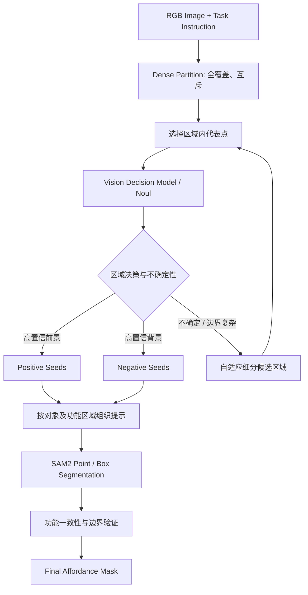

# 2D Affordance 深度调研：任务范式、相关工作、数据集与 Idea 创新性分析

*研究范围：2D Affordance Grounding / Segmentation、Vision-Language Models、Object-Part Segmentation、SAM2 · 截至 2026 年 10 月*

## 一、先给出几个重要结论

你的 Idea 可以概括为：

**利用全覆盖的视觉区域划分，把连续的像素级 Affordance Grounding 问题转化为离散区域上的视觉决策问题，再通过局部细化和 SAM2 恢复精确的 Affordance Mask。**

这条思路是有研究价值的，但需要区分“可以工作”与“具有论文创新性”。

目前调研得到五个关键结论：

1. **2D Affordance 并不是一种单一任务。** 有的工作输出离散的语义分割 Mask，有的输出连续 Affordance Heatmap，有的定位操作点、交互区域或 Bounding Box。它们的输入条件、监督方式和评测协议并不统一。

2. **你的方法与一类 Affordance 任务高度匹配。** 特别是输入 `RGB Image + Action Query`、输出像素级功能区域的 *language-conditioned affordance grounding*。但如果只输入图片、不指定动作，就需要重新定义模型预测什么。

3. **“视觉模型选择交互点 + SAM 分割”已经有人做过。** 尤其值得注意的是 ECCV 2026 的 Affogato: Open-Vocabulary Affordance Grounding with Automated Data Generation at Scale：其数据生成流程已经使用 Gemma、Molmo 和 MobileSAM，并且专门评估了 Molmo + SAM2 基线。因此，单纯组合视觉决策模型与 SAM2 不足以构成强创新。<Cite refs={['turn976818search3','turn976818search7']}/>

4. **全覆盖、互斥的 Dense Partition 是可以严格保证的，但不等于理解了物体或部件。** 这一约束可以通过像素归属算法实现，语义正确性则依赖分区质量。直接使用 SAM2 Automatic Mask Generator 并不能自然保证两个约束同时成立。<Cite refs={['turn984556search0','turn984556search2']}/>

5. **真正值得研究的方向是“区域级功能推理 + 自适应细粒度验证”。** 也就是研究如何以较少的视觉决策次数，找到完整、细粒度、可泛化的交互区域，而非仅仅把若干已有模型串起来。

还有一个对实验设计非常关键的区别：

**像素级 Affordance Mask 和 Affordance Heatmap 不是同一种 Ground Truth。** 例如经典的 AGD20K 使用交互点生成的空间分布热图，并用 KLD、SIM、NSS 评估。直接拿二值 SAM2 Mask 去计算指标，未必能公平比较。<Cite ref="turn713159search43"/>

下面从基础任务定义开始，把相关工作与你的方法逐一对应。

## 二、2D Affordance 究竟是什么任务？

### 2.1 Affordance、Object Part 和 Segmentation 的区别

Affordance（可供性）描述的是：**对于给定的动作或任务，一个物体的哪些区域具有相应的功能。**

它不完全等同于物体类别，也不等同于部件类别。

例如，一张图片里有一把剪刀：

| 问题 | 需要理解的内容 | 输出 |
|---|---|---|
| 这是什么物体？ | Object Recognition | 剪刀 |
| 剪刀有哪些部件？ | Part Segmentation | 手柄、刀刃、连接轴 |
| 哪些位置可以握住？ | Affordance Grounding | 与 `grasp` 对应的区域 |
| 哪些位置可以执行剪切？ | Affordance Grounding | 与 `cut` 对应的区域 |
| 机器人应如何抓住它？ | Grasp Planning | 抓取位置、方向、姿态等 |

最重要的是：**Part 是结构属性，Affordance 是功能属性。**

二者相关，但并非一一映射。一个部件可能具有多种 Affordance；同一种 Affordance 也可能对应多个不相连的部件。STRAP（2023）就明确将 Affordance 建模为多标签问题，例如一个盘子既可以被握持，也可以容纳物品。<Cite ref="turn530820academia54"/>

### 2.2 目前主流的 2D Affordance 任务范式

| 范式 | 模型输入 | 模型输出 | 代表工作 | 与你的 Idea 匹配程度 |
|---|---|---|---|---|
| **A. 传统 Affordance Segmentation** | RGB / RGB-D 图片 | 每像素的功能类别 | UMD、IIT-AFF、STRAP、MaskPrompt | 高，但通常需要多类预测 |
| **B. Action-conditioned Grounding** | RGB 图片 + 动作标签，如 `grasp` | 连续概率热图 | AGD20K、LOCATE、TokAG | 很高，但输出形式存在差异 |
| **C. Instruction-conditioned Segmentation** | RGB 图片 + 自然语言任务 | 二值或多个功能区域 Mask | InstructPart、ReasonAff、Affordance-R1 | **最高** |
| **D. Point / Box-based Localization** | RGB 图片 + 任务 | 点、框，或进一步生成 Mask | OVAL-Prompt、Affordance-R1 | 高，与你的最终 SAM2 阶段很接近 |
| **E. Demonstration-conditioned Grounding** | 目标图片 + 演示图片/视频 | 对应功能区域 | Afformer 等 | 需要额外演示输入 |
| **F. 3D Affordance Grounding** | 点云、RGB-D 或 3D 物体及任务 | 3D 功能区域/热图 | LASO、SceneFun3D、Affogato | 不是同一个直接评测任务 |

这些范式不是完全互斥的：例如一项研究可以同时是开放词汇、语言条件、输出 Heatmap 的方法。

对你来说，最适合首先研究的是 **C 类**，然后再扩展到 **B 类**。原因是你的最后一步使用 SAM2，更自然地得到二值 Mask，而 C 类数据集通常直接提供这类像素级监督。<Cite refs={['turn941348view2','turn949066view0','turn753303view0']}/>

### 2.3 你必须先明确模型究竟接收什么 Query

我建议把任务定义成：

\[
\hat M = F(I,T)
\]

其中：

- \(I\)：RGB 图像，形状为 \(H\times W\times3\)。
- \(T\)：用户的动作、意图或自然语言任务。
- \(\hat M\)：与任务相关的功能区域，形状为 \(H\times W\) 的二值 Mask。

例如：

**输入 → 期望输出**

图片：桌上有一个杯子

任务 A：`Find the region to grasp the cup.`

→ 杯柄，或其他适合握持的区域

任务 B：`Where can I pour liquid into the cup?`

→ 杯口及与倒入液体相关的开口区域

同一张图片，对不同的任务应产生不同结果。因此，如果输入只有 `Image`、没有 `T`，你的模型实际做的可能是“发现所有可能的 Affordance”，那就需要预测：

\[
\mathcal A(I)=\{(a_1,M_1),(a_2,M_2),\ldots\}
\]

它比“给定一个动作，定位对应区域”更开放，评测也更复杂。

### 2.4 二值 Mask 和 Heatmap 的差异

| 二值 Mask | 连续 Heatmap |
|---|---|
| Binary Segmentation | Spatial Probability / Density |
| 每像素属于前景或背景，用于 IoU / F1 评价。 | 每像素是连续响应值，用于 KLD / SIM / NSS 等评价。 |

*示意图仅用于说明输出形式，并非真实数据集样本。*

有些论文将 Mask 定义为 \(M\in[0,1]^{H\times W}\)，它既可以表示软概率，也可以经过阈值化得到二值结果。**但两种监督目标和评价协议仍需区分。** 2026 年 AffordAnything 论文也明确承认这两种表示形式。<Cite ref="turn753303view0"/>

### 2.5 你的 Noul 判断是什么？

这里有一个需要特别说明的细节：**Noul 不是名词（Noun）识别，而是 System One / Decision Model 体系里的一种 Yes/No 判断形式。**

它通常返回一个 \(0\) 到 \(1\) 的数，表示当前问题答案为 Yes 的概率。例如：

\[
s_i=P(\text{Yes}\mid I,T,p_i)
\]

你可以提出问题：

> “对于图中标记的点 P，如果需要执行任务 T，该点是否位于合理的交互区域内？”

Noul 返回的可能是 `0.87`，然后由你的程序决定将其作为正例、负例，还是需要进一步检查的候选。Noul 本身不是一个独立的图像定位算法，**具体 Decision Model 是否支持图片、视觉标记和坐标理解，必须根据所选模型确认**。部分模型的图像支持仍带有实验性限制。<Cite refs={['turn555091search1','turn555091search0']}/>

这反而给你的方案一个清晰的定位：**使用具有视觉输入能力的 Decision Model 作为区域级 Affordance Verifier，而不是让生成式 VLM 直接输出完整分割结果。**

## 三、有哪些值得使用的 2D Affordance 数据集？

这一部分对你最重要，因为**数据集会决定你最后是在研究 Affordance Segmentation，还是 Affordance Grounding，或者 Task-oriented Part Segmentation**。

### 3.1 数据集总表

| 数据集 | 规模与类别 | 输入条件 | Ground Truth | 适合程度 |
|---|---|---|---|---|
| **UMD Part Affordance**（ICRA 2015） | 105 个工具实例，7 种功能 | RGB-D，或只用 RGB | 像素级功能标签、功能排序 | 高 |
| **IIT-AFF**（IROS 2017） | 8,835 张图，10 类物体，9 类功能 | 图片 | 对象与功能部件 Mask | 高 |
| **AGD20K**（CVPR 2022） | 20,061 张第三人称交互图、3,755 张物体视角图；36 种功能、50 类物体 | 图片 + 动作类别 | 测试物体视角的交互热图 | 中高 |
| **OVAS-25**（AAAI 2025） | 18,938 张图，28 类实体、25 种功能 | 图片、开放词汇功能类别 | 像素级功能 Mask | 高 |
| **InstructPart**（ACL 2025） | 2,400 张图，48 类物体、44 类部件；9,600 条任务指令 | **图片 + 自然语言指令** | **任务相关部件 Mask** | **最高** |
| **ReasonAff**（Affordance-R1，2025） | 基于 InstructPart 重构；48 类物体、30 类功能 | 图片 + 隐式任务指令 | 功能 Mask，以及派生点/框 | **最高** |
| **RAGNet**（ICCV 2025） | 27.3 万张图，180 个类别，2.6 万条推理指令 | 图片 + 指令 | 与任务相关的可操作区域 | **很高** |
| **AGD20K-NAT / UMD-NAT**（2026） | 对既有数据集重新划分功能类别 | 图片 + 未见过的功能类别 | 热图 / Mask，依来源而定 | 很适合测泛化 |

数据来源：UMD 官方页面、IIT-AFF 官方页面、AGD20K 原论文、MaskPrompt 原论文、InstructPart 官方页面、Affordance-R1 原论文、RAGNet 代码仓库与 AffordAnything 原论文。<Cite refs={['turn497037view0','turn497037view1','turn849317search4','turn304605search18','turn941348view2','turn949066view0','turn497037view4','turn753303view0']}/>

### 3.2 最值得优先了解的五个数据集

**① InstructPart — 最适合先验证你的方案**

输入是一张图和一条任务指令，要求分割被任务间接指向的部件。例如，不直接说“分割把手”，而是让模型理解“为了完成某操作，需要接触哪里”。

官方数据包括 1,800 张训练图与 600 张评测图，并区分直接部件指代的 ORPS 和需要任务推理的 TRPS。建议优先跑 **TRPS**。<Cite ref="turn941348view2"/>

[论文主页](https://zifuwan.github.io/InstructPart/) · [代码与数据](https://github.com/zifuwan/InstructPart)

---

**② AGD20K — 经典 Affordance Grounding 基准**

这是很多 2D Affordance Grounding 论文会报告的 benchmark。核心是根据动作推断物体的可交互区域，分别测试已见过和未见过的物体类别。

注意它的功能区域标注由交互点密度构成 Heatmap，而非天然二值的 SAM Mask，主要指标为 KLD、SIM、NSS。<Cite refs={['turn849317search0','turn849317search55']}/>

[官方代码与数据说明](https://github.com/lhc1224/Cross-View-AG)

---

**③ IIT-AFF — 适合评估真正的功能部件边界**

提供对象检测框和多个功能类别对应的部件标注，适合检验你的 Dense Partition 能否保留手柄、刀刃等小区域。

但它不是以复杂自然语言任务为核心的数据集。要用 Noul 判断，可以自己把官方 affordance 标签转换成明确的问句。<Cite ref="turn497037view1"/>

[官方数据集](https://sites.google.com/site/iitaffdataset/)

---

**④ ReasonAff — 最接近 Affordance-R1 的评测设置**

它在 InstructPart 的基础上重写指令，使模型需要推理动作意图，并为目标区域派生 Bounding Box 和中心点。因此它与你的最终点提示、SAM2 设计非常接近。要注意派生点是从已有 Ground Truth Mask 计算出来的训练/标注信息，并不是推理时从未知候选区域自动发现的点。<Cite ref="turn949066view0"/>

[Affordance-R1 代码及 ReasonAff 数据](https://github.com/hq-King/Affordance-R1)

---

**⑤ OVAS-25 — 适合探索开放词汇、多类别功能分割**

MaskPrompt 将 IIT-AFF 与重新标注的 Pascal-Part-108 组合，形成 25 个 Affordance 类别的像素级分割 benchmark。它比“给定一个任务，输出一个前景区域”的问题更接近开放词汇语义分割。<Cite ref="turn304605search18"/>

[MaskPrompt 原论文](https://ojs.aaai.org/index.php/AAAI/article/view/32200)

### 3.3 2026 年一个特别值得关注的新 Benchmark：NAT

传统的 AGD20K Unseen 往往指**未见过的物体类别**，不一定是未见过的动作类别。

2026 年的 *Zero-shot 2D Grounding with Novel Affordance Types* 重新定义了更严格的泛化任务：

\[
\mathcal A_{\text{train}}\cap\mathcal A_{\text{test}}=\varnothing
\]

也就是说，训练与测试的 Affordance 类型完全不重合。

它提出 AGD20K-NAT 和 UMD-NAT，并给出 AffordAnything / AffordAnything+ 方法。作者报告，AffordAnything+ 在 AGD20K-NAT 的 IoU@0.4 指标上，相比其选定的 OOAL 基线提升了 **12.3 个百分点**。这是特定新基准和训练设置下的论文结果，不代表它在所有 2D Affordance 任务上都是最优。<Cite ref="turn753303view0"/>

[原论文：Zero-shot 2D Grounding with Novel Affordance Types](https://arxiv.org/abs/2608.08929)

**这与你的研究方向高度相关：** 如果 Noul / Vision Decision Model 真正具备开放词汇的功能判断能力，那么应该检验它在未见过的动作类别上，是否比固定类别的 Affordance 模型泛化得更好。

---

## 四、与你的 Idea 最接近的已有工作

这一部分是创新性调研的核心。我按照“与你方案的重合程度”而非简单发表年份来组织。

### 4.1 直接相关论文对照

| 工作 | 核心做法 | 和你的相似之处 | 关键差别 |
|---|---|---|---|
| **[Set-of-Mark (SoM)](https://arxiv.org/abs/2310.11441)**（2023） | 用 SAM 等生成图像区域，加编号标记，让多模态模型进行视觉定位 | **先分区，再用模型决策** | 不专门研究 Affordance，也没有你要求的全覆盖互斥分区 |
| **[LLM-Seg](https://github.com/wangjunchi/LLMSeg)**（2024） | SAM 生成 Mask Proposals，结合大模型推理与 Mask Selection | 选择候选区域完成语义分割 | 使用 Mask Selection，不以 Noul 点判断为核心 |
| **[OVAL-Prompt](https://arxiv.org/abs/2404.11000)**（2024） | LLM 进行功能推理，VLM 定位对象部件 | 功能知识与 Part Segmentation 解耦 | 以部件语义对应为核心，涉及 RGB-D |
| **[MaskPrompt](https://ojs.aaai.org/index.php/AAAI/article/view/32200)**（2025） | 生成对象 Mask，结合视觉与文本特征预测 Affordance | Mask 作为功能推断的重要中间表示 | 训练式分割方法，并非逐点判断 |
| **[Affordance-R1](https://github.com/hq-King/Affordance-R1)**（2025） | MLLM 推理动作意图，输出 Boxes + Points，再用 SAM 系列模型分割 | **语义判断 → 点/框 → 分割** | 直接生成空间提示，不先把整图互斥划分后逐区域验证 |
| **[RAGNet / AffordanceNet](https://github.com/wudongming97/AffordanceNet)**（2025） | 用大规模数据训练 AffordanceVLM，完成指令条件分割 | 同样解决任务驱动的功能区域理解 | 训练和解码范式不同 |
| **[AffordAnything](https://arxiv.org/abs/2608.08929)**（2026） | Grounded-SAM 检测相关对象，将对象 Mask 拆成局部 Patch，再用 CLIP 匹配功能语义 | **与区域细分、区域功能判断非常接近** | 局部相似度及融合，而非 Noul 二分类与不确定性驱动的迭代选点 |
| **[Affogato](https://junha-l.github.io/affogato/)**（ECCV 2026） | Molmo 预测交互点、MobileSAM 分割，跨视角融合生成 3D 标注 | **视觉点预测 + SAM 分割** | 主要服务大规模 3D 标注和模型预训练 |
| **[TokAG](https://github.com/DrFirstLee/tokAG)**（ECCV 2026） | 利用视觉语言模型的 Token 及注意力信息定位功能区域 | 利用预训练模型的功能知识 | 输出热图，不依赖大量点提示 |

论文与官方实现依据：<Cite refs={['turn849317academia57','turn497037view7','turn297146search4','turn941348search1','turn949066view0','turn497037view4','turn371908view1','turn941348view0','turn941348search5']}/>

### 4.2 我认为你需要精读的三篇

**第一篇：AffordAnything（2026）—— 最直接的技术竞争者**

它的处理方式可以简化为：

`Image + Affordance Text → Grounded-SAM Object Masks → 局部 Patch Refinement → CLIP 局部匹配 + 全局匹配 → Affordance Map`

它已经指出“功能区域往往对应对象的局部子区域”，并用均匀局部 Patch 和边界 Patch 表达细粒度区域，还进行了消融实验。

你的方案与它最大的潜在差异，不是“做不做分区”，而是：

**它通过视觉—文本特征匹配对局部区域赋权；你通过带空间上下文的视觉 Decision Model 判断候选点，再根据不确定性主动调整分区与提示。**

但如果你的细分规则只是“把正例 Mask 再切成更小的 Mask”，创新性依然会比较弱，因为 AffordAnything 已经明确研究了局部候选细化。<Cite ref="turn371908view1"/>

**第二篇：Affordance-R1（2025）—— 最直接的架构竞争者**

其结构为：

\[
(I,T)\xrightarrow{\mathrm{MLLM}}\{(B_i,P_i)\}_{i=1}^N
\xrightarrow{\mathrm{SAM}}\{M_i\}_{i=1}^N
\]

其中 MLLM 通过 GRPO 训练进行功能推理，输出 Bounding Boxes 和 Points，再交给分割模型产生精确 Mask。

这意味着你必须回答一个非常现实的问题：

**为什么要先生成 K 个候选区域、执行 K 次判断，而不是让 Affordance-R1 或其他 VLM 直接预测几个交互点？**

可能的答案包括更完整的区域召回、更好的小部件定位、更强的未见功能泛化，或者更可控的推理预算。但这些必须通过实验验证。<Cite ref="turn949066view0"/>

**第三篇：SoM + LLM-Seg —— 你上游分区与决策方式的已有基础**

SoM 已经使用视觉分割产生不同粒度的候选，再将带编号的区域交给视觉语言模型判断；LLM-Seg 则通过大模型推理选择 Mask Proposals。<Cite refs={['turn849317academia57','turn497037view7']}/>

因此，如果你的论文只说“提出一个新方法：分割图片、给区域编号、让 VLM 选出正例并组合”，审稿人很容易将其理解为 SoM、LLM-Seg 与 SAM 的任务迁移。

更有价值的研究问题应当是：**如何用明确的区域分区约束、可校准的二元决策和自适应查询策略，改善 Affordance Grounding 的覆盖率、精度与推理效率。**

## 五、逐步骤分析你的方法：可行性、风险和改进建议

先用数学形式明确你的第一步。

设图片像素集合为：

\[
\Omega=\{1,\ldots,H\}\times\{1,\ldots,W\}
\]

你的 Dense Partition 要生成：

\[
\mathcal P=\{R_1,R_2,\ldots,R_K\}
\]

并严格满足：

\[
\boxed{
\bigcup_{i=1}^{K}R_i=\Omega,\qquad
R_i\cap R_j=\varnothing\;(i\neq j)
}
\]

这相当于产生一张整型 Label Map：

\[
L\in\{1,\ldots,K\}^{H\times W}
\]

每个像素都有且只有一个区域编号。

### Step 1：全覆盖、不重叠的 Dense Partition

**技术上完全可以做到，但是不建议把“全覆盖互斥”本身当成主要创新点。**

实际上，它是一个可以由分割算法或后处理严格保证的表示约束。

| 生成方案 | 是否容易保证全覆盖互斥 | 语义与边界质量 | 建议 |
|---|---|---|---|
| 规则 Grid | 是 | 通常较差，容易切断部件 | 作为最简单 baseline |
| SLIC / Superpixel | 是，可输出完整区域标签图 | 对纹理边界较好，语义较弱 | **非常适合第一版** |
| SAM2 Automatic Masks | 否，原始 proposals 可能重叠和漏覆盖 | 对对象边界较好 | 需要专门的分区后处理 |
| PartGLEE / LangHOPS | 不天然保证 | 更贴近 Object-Part 语义层次 | 用于构造高质量候选 |
| 对象/部件分割 + Superpixel 补全 | 可以通过标签归属规则保证 | 兼顾语义和完整性 | **值得作为正式方法探索** |

SLIC 的实现和接口可参见 [scikit-image 官方文档](https://scikit-image.org/docs/stable/api/skimage.segmentation)；SAM2 的点、框、Mask 提示能力可参见其官方介绍。<Cite refs={['turn211653view2','turn753303search3']}/>

我建议你的分区分两层设计：

**层级 1：粗粒度　对象 / 大部件**

使用对象分割或 PartGLEE，尽量保留“杯体、杯柄、刀柄、刀刃”等有意义的结构。

**层级 2：细粒度　Superpixel**

在对象与部件内部进一步划分，并为没有被语义模型覆盖的像素分配 Superpixel。

**最终统一生成一个整数 Label Map，使所有区域互斥且没有空洞。**

PartGLEE 和 LangHOPS 都可以为你的语义候选提供结构信息，但两者本质上解决的是对象—部件识别，并不天然满足“所有像素完全覆盖、所有 Mask 互斥”的约束。<Cite refs={['turn211653view3','turn211653view4']}/>

需要注意：**初始候选区域互斥，不意味着 Affordance 类别也应互斥。** 同一个像素可以对不同的动作具有不同功能。你的全覆盖约束应只用于候选分区，而不是强制所有 Affordance 标签只能出现一次。

### Step 2：对每个 Mask 取质心

这是一个合理的起点，但有一个容易忽略的问题：

**几何质心不一定落在 Mask 内部。**

对于凹形区域、环形区域或多个不连通区域构成的 Mask，平均坐标可能落在背景上。

例如，一个环状杯柄的几何中心，可能恰好位于杯柄的空洞里。

因此我更建议使用区域内的代表点，例如：

\[
p_i^*=\arg\max_{p\in R_i}d(p,\partial R_i)
\]

即选择距离区域边界最远的内部像素。

或者先计算质心，再选择 Mask 内部距离质心最近的像素。

还可以测试三种策略：

- **Centroid**：质心或最接近质心的内部点。
- **Interior Point**：距离边界最远的点。
- **Multi-Point**：选择中心与若干具有代表性的补充点。

从实验设计来说，你原始的 Centroid 方案应该保留，作为一个明确的消融实验，而非直接放弃。

### Step 3：使用 Vision Decision Model 执行 Noul 判断

这是你整套方法里最有研究潜力的一环。

对每个候选区域 \(R_i\)，选定代表点 \(p_i\)，输入：

\[
s_i=D_{\mathrm{Noul}}(I,T,p_i)
\]

其中 \(s_i\in[0,1]\)。

但是我不建议把所有区域立即硬分成 `Foreground / Background`。

更合理的方案是：

\[
y_i=
\begin{cases}
\text{Positive}, &s_i\ge \tau_+\\
\text{Negative}, &s_i\le \tau_-\\
\text{Uncertain}, &\tau_-<s_i<\tau_+
\end{cases}
\]

比如可以在验证集上选择两个阈值，保留中间区间作为待验证候选。

这点很重要，因为 Noul 虽然返回概率，但**概率是否在 Affordance 图像分布上校准良好，需要实验确认，不能直接假定 0.9 就意味着 90% 的判断准确率**。

此外，模型最好看到：

`整张图片 + 当前候选点的可视化标记 + 当前任务`

而不是单独得到一个像素坐标。你也可以同时输入局部 Crop，但要保留足够的全局上下文，因为某个区域能否交互有时需要结合整个场景判断。

### Step 4：自适应细化——我建议修改你的原方案

你原本提出：

> 对初步选取的前景 Mask 和点进行更细粒度选点判断。

这个设计存在一个很重要的漏洞：

**如果某个真正的前景区域在第一次判断时被错误地判成负例，它就可能永远失去被纠正的机会。**

这是一个 Recall 问题。

假设图里有一把剪刀，初始分区把一个手柄与附近的背景混在一起，质心落在背景上。Noul 返回 No，那么即使这个区域的一部分包含真实的 `grasp` Affordance，它也不会进入你的细化流程。

因此，不应该只细化正例，还要有选择地细化：

1. 判断不确定的区域；
2. 与正例相邻的负例区域；
3. 纹理和语义高度不一致的大区域；
4. 边界复杂或可能包含细小功能部件的区域。

其中优先级可以定义为：

\[
U_i=
\alpha\,\mathrm{Entropy}(s_i)
+\beta\,\mathrm{BoundaryRisk}(R_i)
+\gamma\,\mathrm{FeatureVariance}(R_i)
\]

再按照 \(U_i\) 选择需要二次分割的区域。

这样一来，你的方法才真正从普通的“粗到细”转向了：

**Uncertainty-Aware Adaptive Affordance Grounding**

这是一个相对清晰、可消融验证的研究方向。

### Step 5：将正负点送入 SAM2

你原来的最后一步基本可行，但需要避免两类问题。

首先，**SAM2 不理解 Affordance 语义本身**。它主要根据点、框和视觉信息选择区域。即使一个点确实属于 `grasp` 功能区域，SAM2 也可能把整个杯体而不是杯柄分割出来。

其次，多个正例可能分布在不同的对象或不连通的功能区域上。直接把所有正点和所有负点一次送入 SAM2，未必能得到正确的全部功能部件。

因此建议：

- 按目标对象、空间连通性或语义组分别构造 SAM2 提示；
- 每组选择若干正点和少量有代表性的困难负点；
- 必要时使用 Bounding Box 限制分割范围；
- 对每个输出 Mask 再进行功能一致性验证；
- 最后合并属于相同任务的多个区域。

尤其不要机械地将几百个背景点全部加入 SAM2。负点质量通常比数量更重要。

---

## 六、我建议你把方法升级成什么样？

你当前的想法是一个线性 Pipeline，而我建议将它变成一个具有反馈和查询预算的自适应系统。

### 推荐方法：Budgeted Hierarchical Affordance Grounding

这个方法需要回答两个不同的研究问题。

**RQ1：离散区域是否能够提升 Affordance 定位的可靠性？**

同一个视觉决策模型，直接看整张图预测交互点，与看候选区域做 Noul 判断相比，哪个更好？

你要验证 Dense Partition 的实际贡献，而不是默认它会有用。

**RQ2：自适应决策能否在有限计算预算内逼近完整的 Affordance 区域？**

是否可以只判断少量候选点，就取得比固定密集采样更高的 Recall 和 IoU？

第二个问题可能比第一个更有论文价值，因为它可以形成明确的优化目标：

\[
\max_{\pi}\quad
\mathbb{E}\big[\mathrm{IoU}(\hat M,M_{\mathrm{GT}})\big]
\]

\[
\text{s.t.}\quad
\mathrm{Cost}(\pi)\le B
\]

其中 \(\pi\) 是决定下一步检查哪个区域、是否细化的策略，\(B\) 是推理预算。

这就把你的系统变成了一个**带预算约束的主动视觉决策问题**。

### 为什么这种修改比原始方法更有价值？

AffordAnything 已经证明局部 Patch 可以帮助 Affordance Grounding，但它也报告了某些失败模式，例如同一个功能对应多个分离区域时，固定 Patch 难以精细表示这些区域。<Cite ref="turn211653view5"/>

你可以专门针对这些问题设计自适应分区与查询策略。

相较于“所有区域都问一次 Noul”，重点变为：

**哪些区域值得问？哪些区域值得继续细分？什么时候已有证据足以生成最终 Mask？**

另外，如果确实使用 Decision Model，而非普通生成式 VLM，你还可以研究二元概率判断是否提供了更稳定、可控制的交互接口。但这需要在同等计算条件下验证，不能仅因为模型输出概率就认定它比生成式 VLM 更可靠。

---

## 七、你的 Idea 究竟有多大的创新性？

我将创新性分成不同层次评估。

| 设计成分 | 已有研究覆盖情况 | 单独作为论文创新点的潜力 |
|---|---|---|
| Dense Partition 全覆盖、互斥 | 经典图像分区已有此性质 | 低 |
| 每个分区取代表点 | 普通采样策略 | 低 |
| 视觉模型判断区域是否具有功能 | VLM / CLIP 区域判断已有大量相关工作 | 低至中 |
| Noul 二元功能判断 | 属于较新的模型接口应用 | 中，取决于是否证明独特优势 |
| 正例细化 | AffordAnything 等已有局部细化 | 低至中 |
| 正负点提示 SAM2 | 已有 Point/Box + SAM 范式 | 低 |
| 不确定性驱动的层次化区域查询 | 与已有方法相关，但可设计更具体问题 | **中至高** |
| 功能感知的边界与多区域一致性验证 | 取决于实现和理论/实验结果 | **中至高** |
| 在固定推理预算下显著提升 OOD 泛化 | 如果有充分实验证据 | **有较强研究潜力** |

这是基于目前核对的文献做出的研究判断，不是对全球所有尚未公开工作做出绝对的新颖性保证。

### 我最担心审稿人提出的三个问题

**问题一：为什么一定需要 Dense Partition？**

既然最终还要用 SAM2 分割，是否直接用 VLM 找点更简单？

你需要证明 Dense Partition 在小区域召回、多个功能区域覆盖、开放词汇判断或推理稳定性方面带来实质收益。

**问题二：为什么要用 Noul，而不是 CLIP / VLM Score / Mask Classification？**

如果 Noul 只是一个黑盒二分类器，其价值必须通过对比来说明，包括判断精度、校准、推理成本与 OOD 表现。

**问题三：为什么需要逐点询问？**

如果每张图有 200 个 Mask，就意味着可能需要大量视觉决策。如果推理时间明显高于其他方法、精度提升又有限，会影响方法的实际价值。

解决这个问题可以借鉴 SoM：先在图像中标记多个候选区域，让视觉模型一次或分批处理多个区域，而非每个点重新编码整张图片。<Cite ref="turn849317academia57"/>

这三点应该成为论文实验设计的核心，而不只是放在 Limitations 中。

---

## 八、怎样设计一个能验证创新性的实验？

### 8.1 先做最小可行实验

建议不要一开始就研究全部 2D Affordance Benchmark。

先选择 **InstructPart 的 TRPS 任务**，因为它与你的输入输出最贴近：

\[
\text{Input}=(I,T),\qquad
\text{Output}=\hat M
\]

先把模型、数据输入、点判断、SAM2 输出、IoU 评价全部跑通。

### 8.2 必须包含的 Baselines

| 编号 | Baseline | 要回答的问题 |
|---|---|---|
| B0 | VLM 直接预测点/框 + SAM2 | 分区机制是否真的必要？ |
| B1 | SoM 区域标记 + VLM 直接选 Mask | Noul 逐点决策是否优于直接选区域？ |
| B2 | AffordAnything 的局部区域方法 | 你的自适应决策是否优于已有 Patch Refinement？ |
| B3 | Dense Partition + 单点 Noul + Mask 并集 | 不使用 SAM2，区域分类能达到什么效果？ |
| B4 | Dense Partition + Noul + SAM2 | 你的原始主干是否有效？ |
| B5 | B4 + 只细分正例 | 验证原始细化策略 |
| B6 | B4 + 不确定性/边界驱动的细化 | 验证新策略能否改善 Recall |
| B7 | B6 + 多点采样/功能一致性验证 | 验证完整方法 |

AffordAnything 论文截至本次核查给出了方法描述并表示将开放代码；若实验时无法获得官方实现，必须将复现结果与论文原报结果区分，避免不公平比较。<Cite ref="turn753303view0"/>

### 8.3 不要只看最终 IoU

我认为你至少需要三组指标。

**最终分割性能**：mIoU、gIoU、cIoU、F1；根据目标数据集官方定义选择。

**中间区域决策质量**：Region Precision / Recall、Positive Seed Recall、Noul 判断准确率与概率校准、最终错失的真实功能区域比例。

**计算效率**：每张图片的 Noul Decision 数量、视觉编码次数、总推理时间、Token/API 成本，以及性能随决策预算变化的曲线。

尤其建议加入一个非常有解释力的指标：

### Partition Oracle Upper Bound

假设我们已经知道 Ground Truth，针对当前 Dense Partition，选择最佳区域组合，理论上最高能达到什么 IoU？

\[
\mathrm{OracleIoU}(\mathcal P)
=
\max_{S\subseteq\{1,\ldots,K\}}
\mathrm{IoU}
\left(
\bigcup_{i\in S}R_i,M_{\mathrm{GT}}
\right)
\]

这个指标只用于评估，不参与正常推理。

它能区分两种不同的失败：

- 分区本身太粗，即使决策模型百分之百正确，也无法产生精确 Mask；
- 分区已经足够好，但 Noul 误判导致结果不好。

有了这个指标，你才能科学地分析“增加区域数量”和“增加判断能力”哪个更重要。

### 8.4 最重要的消融实验矩阵

| 实验变量 | 建议比较 |
|---|---|
| Partition 方法 | Grid / SLIC / SAM2+补全 / PartGLEE+补全 |
| 区域数量 | 不同 K 值，例如 64、128、256、512 |
| 选点方法 | Centroid / 最深内部点 / 多点 |
| 决策方式 | Noul / 普通 VLM Yes-No / 区域特征相似度 |
| 查询上下文 | 全图标点 / 局部 Crop / 全图+局部 |
| 细化策略 | 不细化 / 只细化正例 / 细化不确定区域 |
| SAM2 Prompt | 仅正点 / 正负点 / 正点+框 / 分组多点 |
| 推理预算 | 固定 16、32、64、128 次决策等 |

这些预算数值是建议的实验档位，不代表实际模型的能力上限。

### 8.5 Benchmark 使用顺序

**阶段一：InstructPart + ReasonAff**

验证自然语言条件下的定位正确性，评估二值 Mask、推理复杂度、小部件召回。

**阶段二：IIT-AFF + UMD + OVAS-25**

验证功能类别定位和边界精度，同时测试多功能标签和开放词汇设定。

**阶段三：AGD20K + AGD20K-NAT**

扩展到 Heatmap 或概率输出，并严格遵守对应数据集的 KLD、SIM、NSS 与 NAT 划分协议。

对 AGD20K，如果采用 SAM2 二值 Mask，至少应先定义一个从 Mask/区域概率到连续空间响应的固定转换方案，而不能直接宣称它与原始热图模型在完全相同的任务设置下可比较。

值得参考的是 Affogato 的实验。在作者报告的 AGD20K Unseen 零样本比较中，Molmo+SAM2 的 KLD 为 1.953、SIM 为 22.6（百分制表示）；Espresso-2D 在使用 Affogato-750K 预训练的设置下达到 KLD 1.571、SIM 37.6。这说明单纯点提示接 SAM2 仍有明显改进空间，但两者的训练数据与方法不同，不能把差距全部解释为架构优势。<Cite ref="turn941348view0"/>

---

## 九、还有两个值得继续关注的方向

### 9.1 Scene-level、One-to-Many Affordance

真实场景里，一条任务指令可能对应多个物体、多个部件，甚至多种可行操作方式。

2026 年的 Affordance2Action (A2A) 正在探索面向真实操作的场景级、任务条件功能定位，强调一个任务对应多个有效交互区域。它非常符合你使用 Dense Partition 实现完整区域发现的目标。

但截至本次核查，官方仓库的 A2A-Bench 仍标注数据托管进行中，部分模型代码也尚未完整开放，暂时不建议将其作为你最先依赖的实验基准。<Cite ref="turn497037view5"/>

[A2A 官方代码仓库](https://github.com/arc-l/a2a)

### 9.2 从 Binary Segmentation 转向 Functional Probability Field

如果未来你希望与更多 2D Affordance Grounding 工作公平对比，可以不只让每个区域输出正负类别，而是保留决策概率：

\[
S(x)=s_i,\qquad x\in R_i
\]

随后在区域边界与 SAM2 结果上进行平滑或概率融合，输出连续空间响应。

这样你的框架可同时支持：

- 二值 Affordance Segmentation；
- 连续 Affordance Grounding；
- 对不同任务输出不同概率图。

但要小心：**Noul 的判断概率不自动等于真实交互位置的概率密度。** 如果要把它视作 Heatmap，需要额外验证概率定义、校准和归一化方式。

---

## 十、我建议的论文定位与实际研究路线

经过对已有工作的比较，我不建议把论文贡献写成：

> 我们提出一种通过 Dense Partition、Noul 和 SAM2 进行 Affordance Segmentation 的方法。

这个描述太像现有视觉模块的组合。

更有竞争力的研究定位是：

> **Budgeted Hierarchical Affordance Grounding via Region-Level Visual Decisions**

可考虑以下三个核心贡献：

**贡献一：Function-Aware Dense Region Representation**

提出一个全覆盖、无重叠、支持层次化细分的区域表示，使功能判断可以在图像中的任何位置进行，并分析分区粒度对功能区域定位的理论上界。

**贡献二：Uncertainty-Guided Visual Decision**

将 Affordance Grounding 建模为视觉区域的二元概率判断，通过不确定性与边界信息，主动选择需要额外检查的候选区域，从而减少判断成本并改善召回。

**贡献三：Semantic-Consistent Prompt Refinement**

结合正负区域证据与 SAM2 分割，并引入功能一致性检查，在多个不连通目标和细粒度功能部件上取得更稳定的结果。

当然，这些目前是**研究假设和潜在贡献**，只有完成实验并证明收益后才能在论文中作为已实现贡献来表述。

### 具体执行建议

我建议先做一个非常干净的基础系统：

`InstructPart → SLIC Partition → 内部代表点 → Noul → 正负点 → SAM2 → IoU`

然后优先回答下面三个问题：

1. 不进行任何细化，这套框架能达到什么水平？
2. 与 VLM 直接预测点再交给 SAM2 相比，有没有优势？
3. 在相同的 Noul 查询预算下，自适应细化是否明显优于固定采样？

如果前两个问题的答案都是“没有明显优势”，应及时重新审视 Dense Partition 这一假设，而不是继续叠加模型。如果基础方法有效，再投入精力做层次化、预算优化和泛化实验，会更有把握。

## 最后的判断

**你的 Idea 与现有 2D Affordance 任务是匹配的，尤其匹配基于自然语言指令的 Affordance / Part Grounding；但是“全覆盖分区、逐点判断、正负点交给 SAM2”这一组合本身，新颖性还不够强。**

它最有可能发展成一篇有说服力的研究论文的地方，是将问题提升为：

**在有限视觉决策预算下，通过全覆盖的候选区域表示、概率化功能判断和主动细化，实现开放词汇、细粒度、多区域的 2D Affordance Grounding。**

我认为最值得你下一步精读、复现和作为核心对照的四项工作是 **AffordAnything（2026）、Affordance-R1（2025）、InstructPart（2025）和 Affogato（2026）**。它们分别对应你的区域候选、任务推理、实验基准以及点提示分割四个关键环节。
