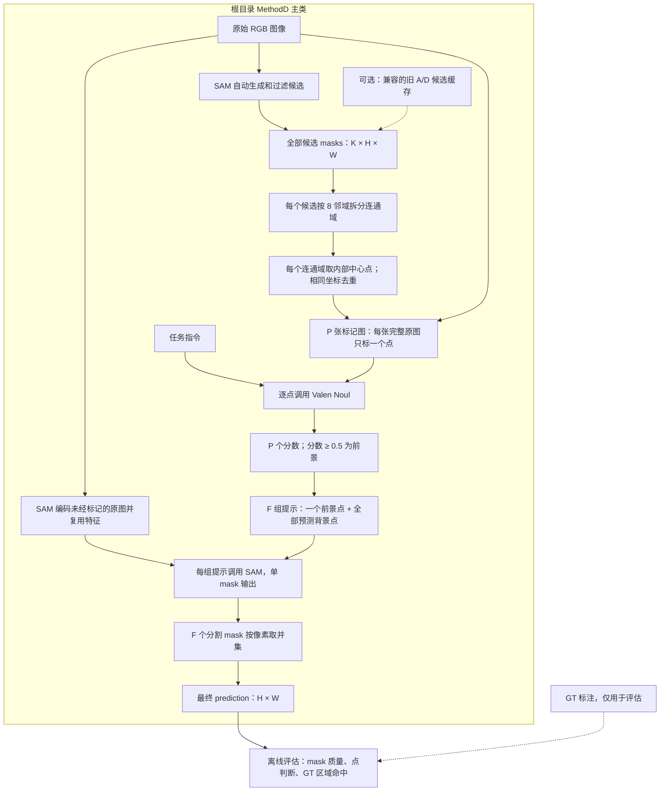
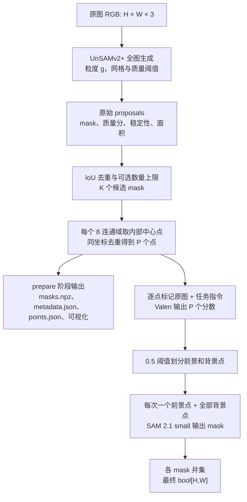
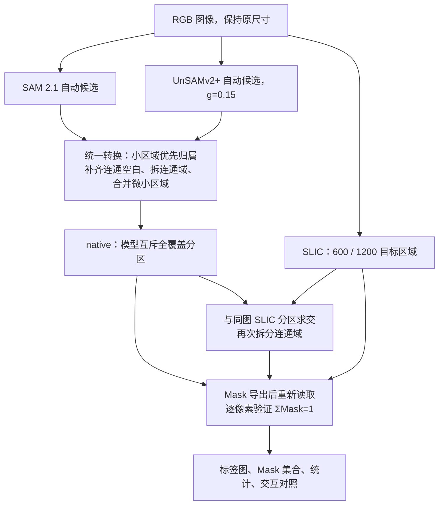
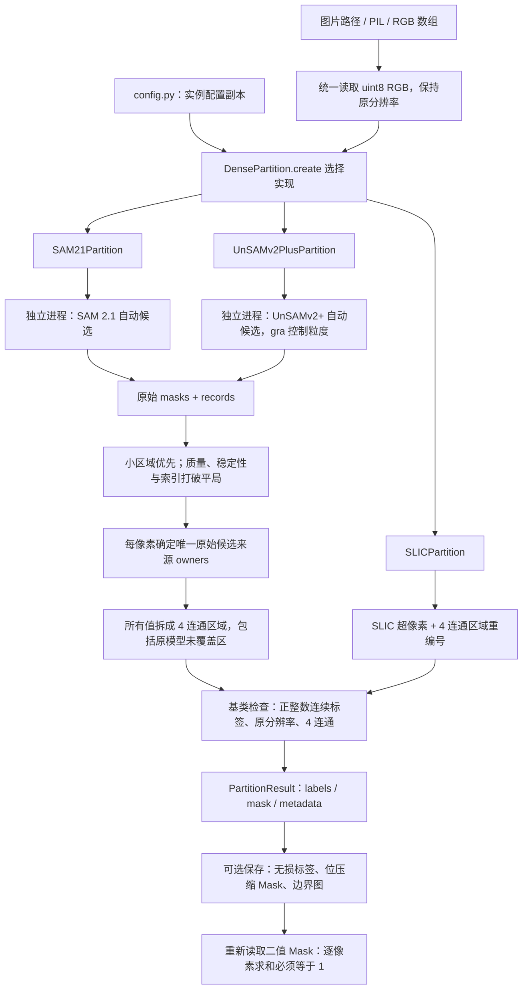

# 方法 D：初版流程、结果诊断与改进

创建日期：2026-10-17。

本文详细记录方法 D 的第一版实现，并作为后续讨论、对照实验和改进的记录入口。总体实验方案见 [04 最小 Affordance 决策测试](04_minimal_affordance_test.md)。

**当前状态（2026-10-18）：只保留 Dense Partition 分割阶段。** 根目录主接口为 `dense_partition.py`，统一支持 SAM 2.1、UnSAMv2+、SLIC；参数和 debug 图片列表集中在 `config.py`。完整 D、Valen 判断、取点与任务评估代码、旧 `configs/` 均已删除，当前结构与接口见第 13 节及 [README](../README.md)。

**第 1～12 节保留历史流程、实验数据与研究讨论。** 其中旧文件、命令、配置均对应重构前提交 `3d62972`，不再是当前代码的使用方式；请在独立历史 checkout 中复现旧实验。最初原型对应 `3d57ce5`。历史结果仍有研究价值，保留不代表当前继续运行完整 D。

| 当前入口 | 作用 |
| --- | --- |
| [dense_partition.py](../dense_partition.py) | 基类、三种算法实现、统一工厂 |
| [config.py](../config.py) | 参数、模型资源与 debug 图片 |
| [common](../common/) | 通用分区转换、验证、导出、推理和可视化 |
| [environment.yml](../environment.yml) | Miniconda 环境定义 |

## 1. 初版要解决什么问题

输入一张图片和一条任务指令，输出与原图同尺寸的二值 mask，覆盖指令要求的交互部位。任务可以对应一个区域，也可以对应多个分离区域。

D 使用自动分割候选来安排采样点，再通过点判断传递指令信息。一个点被接受，只说明模型认为该位置符合任务，不能据此接受整个原始候选。因此，初版会用预测前景点重新提示 SAM。

当前程序默认由 `MethodD.prepare_image()` 直接生成候选。也可用 `candidate_cache` 导入兼容的旧 A/D 运行目录，以核对重构前后的结果。**导入旧 A 时，复用的是 A 的全部候选，不是 A 的 Valen 判断后接受的候选。** 候选内容和点算法保持一致，不再需要运行 A 脚本。

## 2. 初版流程图



没有可用点或没有预测前景点时，直接得到全零的最终 mask，并记录原因；图中这两条空预测分支为简洁起见未展开。

不支持 Mermaid 的阅读器可以看下面的文本流程：

```text
D 自行生成或从兼容缓存导入的全部候选 mask
    → 拆分连通域
    → 每个连通域取内部中心点并去重
    → 每点生成一张完整原图上的标记图
    → 标记图 + 指令 → Valen → 点分数与预测标签
    → 每个预测前景点 + 全部预测背景点
    → 使用未经标记的原图提示 SAM，逐次得到单 mask
    → 全部 mask 取并集
    → 保存预测后，读取 GT 并评估
```

## 3. 输入、符号与核心中间变量

记图像高度为 `H`、宽度为 `W`，自动候选数为 `K`，所有候选的连通域总数为 `L`，坐标去重后的点数为 `P`，预测前景点数为 `F`。预测背景点数是 `P - F`。

`P` 由连通域数量决定，不固定为 32，也不等于 `K`。不同候选产生相同坐标时会去重，所以 `P ≤ L`。

| 变量 | 类型或形状 | 含义 |
| --- | --- | --- |
| `candidate_cache_config` | 可选的配置记录 | 导入缓存时记录原来的候选生成配置；当前点阈值独立设置 |
| `manifest` | 字典 | `read_manifest()` 直接读取的当次样本清单，每条任务包含图片、指令等 |
| `row` | 字典 | 当前任务，含 `id`、`image`、`instruction`、`candidate_key` 等 |
| `config` | 字典 | 本次 D 的模型、提示模板、取点和分割配置 |
| `rgb` | `uint8[H, W, 3]` | 原始 RGB 图像 |
| 准备阶段的 `masks` / 任务阶段的 `candidates` | `bool[K, H, W]` | D 生成或导入的全部候选 |
| `components` | `int32[K, H, W]` | 每个候选的连通域编号图，0 为候选外的像素 |
| `points` | 长度为 `P` 的列表 | 点 ID、整数坐标和来源映射 |
| `self._prepared` | 以完整图像 SHA-256 为键的字典 | 缓存 `PreparedImage`：原图、候选、连通域、点及元数据 |
| `records` | 长度为 `P` 的列表 | 每点的请求、响应、Noul 分数、判断和耗时 |
| `scores` | 长度为 `P` 的浮点列表 | 每点的 Noul true 分数 |
| `prompts` | 长度为 `F` 的列表 | 每个预测前景点对应的一组 SAM 提示 |
| `coords` | `float32[1 + P - F, 2]` | 当前前景点和全部背景点的原图坐标 |
| `point_labels` | `int32[1 + P - F]` | 对应提示标签，首项为 1，其余为 0 |
| SAM 返回的 `masks` | `(1, H, W)` | 当前一次提示的单 mask 输出；代码复用了变量名 |
| `quality` | `(1,)` | SAM 对该 mask 的质量预测 |
| `segmentations` | 长度为 `F` 的列表，每项 `bool[H, W]` | 每次 SAM 分割的 mask，包括可能为空的 mask |
| `prediction` | `bool[H, W]` | 最终合并结果 |
| `metrics` / `point_metrics` | 字典 | 最终 mask 的评估和点级评估 |

坐标统一使用原图像素单位：保存及传给 SAM 时是 `[x, y]`，访问 NumPy 图像或标签数组时是 `[y, x]`。它们不是归一化到 0～1 的坐标。

## 4. 初版逐步实现

### 4.1 读取配置，确定本次任务

根目录入口 `run_method_d.py` 的初版兼容参数包括 `--manifest`、`--output`、`--device`、`--threshold` 和可选的 `--candidate-cache`。默认清单为 `configs/umd_debug.json`，输出为 `outputs/method_d_run`，设备为 `cuda:1`，阈值为 0.5。新增候选模型、粒度、数量上限及只准备候选的参数见第 11 节。

主类初始化时校验阈值，建立新输出目录，固定随机种子为 0；模型按需加载。`run_manifest()` 通过 `read_manifest()` 检查任务 ID、指令、文件路径和图像内容哈希，并保存当次清单。`threshold` 由当前实例设置，不再继承旧 A 配置。

导入候选缓存时额外检查它来自 A/D，候选准备完成，SAM revision、候选生成和过滤配置兼容。候选像素数组还要匹配当前图像哈希、尺寸和布尔类型。

GT 路径 `label` 和类别 `target_label` 只用于最后评估，可以同时省略。输出目录必须是新目录，任务 ID 也不能在同一目录中重复使用。

### 4.2 生成或导入每张图片的全部候选

`candidate_key` 是图像 SHA-256 的前 16 位，用于目录名称；主类用完整 SHA-256 缓存 `PreparedImage`。相同内容的图片可复用候选和点，换指令时重新执行判断。

```python
prepared = pipeline.prepare_image(image_path)
rgb = prepared.rgb                 # uint8[H, W, 3]
candidates = prepared.candidates   # bool[K, H, W]
points = prepared.points
```

默认路径由 `_generate_candidates()` 使用 SAM 2.1 small 生成并过滤候选。算法参数保持初版：每边 32 个自动采样点、1 层 crop、预测 IoU 阈值 0.8、稳定性阈值 0.95、`min_mask_region_area=0`；过滤空 mask 和 IoU 不低于 0.90 的重复候选，最多保留 24 个。超过上限时按面积排序分组保留，以覆盖不同大小的候选。

指定 `candidate_cache` 时读取旧运行的 `candidates/<key>/`，校验后复制到新输出目录，跳过自动候选生成。无论哪种路径，候选都可以重叠、嵌套和包含多个连通域，也都不读取 A 的接受分数或 `selected_ids`。

### 4.3 拆分连通域，计算内部中心点并去重

调用 `component_centers(masks)`。对每个候选：

1. 用 `scipy.ndimage.label` 和全 1 的 `3 × 3` 邻域结构做 8 邻域连通域标记。
2. 对一个连通域，取得全部像素坐标 `xs`、`ys`，计算均值 `cx = xs.mean()`、`cy = ys.mean()`。
3. 在该连通域内，找到使 `(x - cx)² + (y - cy)²` 最小的实际像素。
4. 若有多个像素距离相同，按行、列顺序选择第一个。
5. 用整数坐标 `(x, y)` 查重。完全相同的坐标保留为一个点，但追加所有来源信息。

这样选出来的点一定在来源连通域内，适用于几何中心落在背景上的凹形、环形区域。这里使用的是“离几何中心最近的内部像素”，没有计算距离边界最远点，也没有使用 bbox 中心。

点 ID 和候选 ID 从 0 开始；每个候选内部的连通域编号从 1 开始，不是跨候选的全局编号。一个点可以有多个来源。

下面是刀刃样本中的实际点，几何中心小数做了截断展示：

```json
{
  "id": 5,
  "xy": [289, 202],
  "sources": [
    {
      "candidate_id": 5,
      "component_id": 1,
      "area": 2336,
      "centroid_xy": [289.0261, 202.1712]
    }
  ]
}
```

保存 `components.npz` 和 `points.json`，并在 `PreparedImage.point_metadata` 中记录点集、连通域数、点数、耗时和来源 mask 文件哈希。同图换指令时，这些内容全部复用。

**初版没有额外过滤微小连通域，没有最小点间距规则，也没有固定点数上限。** 例如本次勺子图的 16 个候选产生了 35 个连通域和 35 个点。

### 4.4 每个点生成一张标记图

`mark_point(rgb, xy)` 复制完整原图，只围绕当前点画一个空心标记：青色圆环半径 5 像素、线宽 2 像素，外侧黑色边框半径 6 像素。中心像素保持原样；图像边缘处的标记会被画布裁切。

每个点保存为 `point_XXX.png`，另保存点图总览 `points.jpg`。每张输入图只标一个点，不把全部点同时画上，也不裁剪为局部图片。

### 4.5 加载模型，逐点执行 Valen 判断

程序加载本地 SAM 2.1 small 和 Valen-4B，分别预热并记录加载、预热耗时。GPU 上 SAM 使用 bfloat16 autocast；Valen 主干使用 bfloat16，决策头保留 float32，使用 `sdpa`、`execution='shared_state'`、`temperature=1.0`。

对每条任务，依次遍历 `P` 个点。每次通过主类的 `_request()` 构造请求，实际输入为“完整点标记图 + 当前任务指令 + 固定判断说明”。Valen 不单独接收坐标数组，也不接收候选 mask 数组。

当前英文提示模板为：

```text
Task: {instruction}
The center of the small cyan ring marks one image pixel. Judge the original surface at the center, not the ring itself. Other points may also be valid. Being on the right object is insufficient: the point must lie on the functional part requested by the task.
```

Noul 问题为：

```text
Does the pixel at the center of the cyan ring belong to a functional part requested by the task?
```

请求结构中保留了来自 A 的问题键名 `region`，在 D 中它对应的是上述点问题：

```python
request = {
    'state': {'messages': [{'role': 'user', 'content': [
        {'type': 'text', 'text': config['prompt'].format(instruction=instruction)},
        {'type': 'image_url', 'image_url': {'url': str(marked_image_path)}}
    ]}]},
    'questions': {'region': {'type': 'noul', 'instructions': config['question']}}
}
response = model.predict(request, execution='shared_state', temperature=1.0)
score = read_noul(response)  # response['answers']['region']['noul']
accepted = score >= config['threshold']
```

`read_noul()` 检查响应类型及分数是否为 0～1 的有限数。每个点独立判断，多个点可以同时被接受；全部点的分数不要求相加等于 1。

每个点保存一条 `record`，包含 `point_id`、`xy`、`sources`、`noul`、`accepted`、`seconds`、完整 `request` 和 `response`。随后构造 `scores = [r['noul'] for r in records]`。

同图不同指令需要重新执行这一步。它们共享点坐标，但不共享点的预测标签。当前没有将多个点的判断合并成一次模型请求。

### 4.6 为每个前景点构造 SAM 提示

调用 `sam_point_prompts(points, scores, threshold)`，先把点分为：

```python
positives = [i for i, score in enumerate(scores) if score >= threshold]
negatives = [i for i, score in enumerate(scores) if score < threshold]
```

这里的标签全部来自 Valen 的预测。当前没有“不确定”类别：低于阈值的每个点都会进入背景点集合。

对每个预测前景点，构造“该前景点 + 全部预测背景点”。其他预测前景点不参与这次提示，也不会被改成背景点。例如：

```text
预测前景：p2、p5
预测背景：p0、p1、p3

第 1 次提示：coords = [p2, p0, p1, p3]，labels = [1, 0, 0, 0]
第 2 次提示：coords = [p5, p0, p1, p3]，labels = [1, 0, 0, 0]
```

`prompts` 的每一项为 `(point_id, coords, point_labels)`。有 `F` 个预测前景点就构造 `F` 组提示，每组包含 `1 + P - F` 个点。

如果所有点都被预测为前景，每次提示只有一个正点；如果没有前景点，就没有任务分割调用。程序启动时的 SAM 预热调用单独记录，不属于这里的调用数。

### 4.7 给 SAM 原图，逐个前景点重新分割

有可用提示时，使用未经标记的原图调用 `predictor.set_image(rgb)`。图像特征保存在 `predictor` 内，同图的所有提示复用这份特征。

`self._embedding_key` 记录当前已编码的图片。连续处理同图的不同指令时也可复用；它不是保存全部图片特征的字典，换图后再回来仍需要重新编码。

随后逐次调用：

```python
masks, quality, _ = predictor.predict(
    point_coords=coords,
    point_labels=point_labels,
    multimask_output=False,
)
mask = masks[0].astype(bool)
segmentations.append(mask)
```

每次得到一个与原图同尺寸的 mask，并保存为 `segment_point_XXX.png`。另在 `segmentation_records` 中记录点 ID、全部提示坐标和标签、`quality[0]`、mask 面积及调用耗时。

初版有四个明确边界：

- SAM 接收原图和坐标、标签，不接收自然语言指令，也不接收 Valen 看到的标记图。
- 原始候选只参与取点，没有作为 SAM 的 mask 输入、box 提示或最终边界约束；新分割可以超出原候选。
- `multimask_output=False`，且建模时 `apply_postprocessing=False`。
- SAM 的 `quality` 仅被保存，没有作为额外接受阈值；它也不是与 GT 计算得到的实际 IoU。

### 4.8 按像素取并集，得到最终预测

将 `segmentations` 中的全部 mask 做逻辑 OR，等价于：

```python
prediction = np.zeros((H, W), dtype=bool)
for mask in segmentations:
    prediction |= mask
```

实际代码复用 `merge_masks(segmentations, [1.0] * len(segmentations), 0.5, shape)`。这里传入的全 1 分数只是让所有分割结果参与合并，不是再次做 Noul 判断。

重叠像素只计一次；分离区域全部保留，不只保留最大的连通域。保存成 `prediction.png` 时，前景为 255、背景为 0。

空结果通过 `empty_reason` 区分：

| 值 | 含义 |
| --- | --- |
| `no_points` | 没有可用采样点 |
| `no_positive_points` | 有点，但没有点达到 Noul 阈值 |
| `sam_returned_empty` | 有预测前景点，但全部 SAM 结果合并后仍为空 |
| `null` | 合并结果非空 |

初版不会强制把最高分点变成前景，也不会在空结果时回退为原始候选。

### 4.9 预测完成后读取 GT，评估并汇总

有标注时，直到此处才打开 `.mat` 文件中的 `gt_label`：

```python
labels = loadmat(label_path)['gt_label']
valid = labels >= 0
target = (labels == target_label) & valid
```

当前把负数标签像素排除于评估，这是调试约定；Clutter 的正式有效像素规则仍需核实。GT 不参与候选生成、取点、Valen 判断或 SAM 提示。

评估包括两部分：

- `metrics`：最终 IoU、像素精确率、召回率、TP/FP/FN、GT 像素数、忽略像素数，以及原始候选覆盖率和最佳单候选 IoU。
- `point_metrics`：点级 TP/FP/TN/FN、忽略点数、GT 连通域数、全部采样点和预测前景点分别命中的 GT 连通域数。

点命中只表示至少一个点落在该 GT 连通域内，不表示后续分割完整覆盖了它。原始候选覆盖率也不是 D 最终召回率的硬上限，因为 D 会重新分割。

当前像素评估函数将无预测像素时的 precision 定义为 1。如果直接平均各任务 precision，空预测会抬高均值；分析时应同时报告空预测数量和汇总像素计数。

## 5. 实际例子：刀刃切割任务

以 [knife_cut 的完整记录](../outputs/method_d_debug/samples/knife_cut/scores.json) 为例：

```text
输入图像：H = 480，W = 640
任务：Find all parts used to cut other objects.
GT 目标类别：2，仅用于最后评估

候选 masks：bool[11, 480, 640]
    ↓
连通域 components：int32[11, 480, 640]
连通域总数 L = 11，去重后 P = 11
    ↓
11 张点标记图，11 次 Valen 判断
    ↓
点 #5：[289, 202]，Noul ≈ 0.9472 → 预测前景
点 #9：[406, 268]，Noul ≈ 0.7604 → 预测前景
其余 9 个点 → 预测背景
    ↓
第 1 组：#5 + 9 个背景点，coords.shape = (10, 2)
第 2 组：#9 + 9 个背景点，coords.shape = (10, 2)
两组 point_labels 都为 [1, 0, 0, 0, 0, 0, 0, 0, 0, 0]
    ↓
SAM 第 1 次输出：1133 个前景像素，quality ≈ 0.5117
SAM 第 2 次输出： 105 个前景像素，quality ≈ 0.3633
    ↓
两个 mask 取并集，本例没有重叠：1238 个前景像素
    ↓
最终 prediction.shape = (480, 640)
与 GT 比较：IoU ≈ 0.4905
```

第二个 mask 的 SAM 质量分低于 0.5，但仍被合并，因为 0.5 是本次 Noul 的点接受阈值，当前并未对 SAM 质量分设阈值。“预测前景”也不意味着真实前景；GT 检查表明本例 #9 位于刀柄，属于点判断错误。

## 6. 输出文件与复现方式

### 6.1 输出目录

```text
outputs/method_d_debug/
├── run.json                         # D 配置、模型版本、加载和预热耗时
├── manifest.json                    # run_manifest() 直接读取并保存的当次样本清单
├── candidates/<candidate_key>/      # 按图片保存，同图不同任务共享
│   ├── original.png
│   ├── masks.npz                    # D 生成或导入的全部候选
│   ├── metadata.json                # 候选元数据和生成耗时
│   ├── mask_XXX.png                 # 逐候选 mask
│   ├── components.npz               # 各候选的连通域编号图
│   ├── points.json                  # 点坐标、来源、数量和耗时
│   ├── point_XXX.png                # 实际给 Valen 的单点标记图
│   └── points.jpg                   # 点图总览
├── samples/<sample_id>/             # 按“图像 + 指令”保存
│   ├── response_XXX.json            # 每点请求、原始响应与判断
│   ├── segment_point_XXX.png        # 每个预测前景点的 SAM mask
│   ├── segmentations.json           # SAM 提示、质量分、面积、耗时
│   ├── prediction.png              # 最终二值 mask
│   ├── scores.json                  # 任务汇总和全部点记录
│   ├── scores.jpg                   # 带分数的点图总览
│   ├── evaluation.json              # 有 GT 时保存
│   ├── ground_truth.png             # 有 GT 时保存
│   ├── valid_pixels.png             # 有 GT 时保存
│   └── comparison.png               # 原图、预测、可选 GT 对照
├── summary.json
├── summary.csv
└── overview.jpg
```

导入旧 A 缓存时，候选目录还会包含复制过来的高亮图等文件，上面没有逐项列出。运行日志不是 D 自动创建的，而是运行命令通过输出重定向保存到 [method_d_debug.log](../outputs/method_d_debug.log)。

### 6.2 重构后的运行示例

环境创建与模型安装见 [仓库 README](../README.md)。当前机器使用 Miniconda 的独立环境 `systemone-affordance`，不依赖原来的 `.venv`。在仓库根目录运行：

```bash
source /home/hri/miniconda3/etc/profile.d/conda.sh
conda activate systemone-affordance
unset PYTHONPATH
python run_method_d.py \
  --manifest configs/umd_debug.json \
  --output outputs/method_d_run \
  --device cuda:1
```

上面的默认流程直接生成候选。要复用旧 A 候选做重构回归比较，使用一个新输出目录并增加参数：

```bash
python run_method_d.py \
  --manifest configs/umd_debug.json \
  --candidate-cache outputs/method_a_debug \
  --output outputs/method_d_cached_rerun \
  --device cuda:1
```

也可以直接使用根目录主类：

```python
from method_d import MethodD

with MethodD(device="cuda:1", output_dir="outputs/my_prediction") as pipeline:
    result = pipeline.predict(
        "data/umd/tools/knife_01/knife_01_00000122_rgb.jpg",
        "Find all parts used to cut other objects.",
        sample_id="knife_cut",
    )
    mask = result.mask
    points = result.prepared.points
    records = result.records
    segmentations = result.segmentations
```

`predict()` 不接受 GT；`run_manifest()` 在预测完成后执行可选评估。省略 `output_dir` 时，主类使用临时目录，`close()` 或退出 `with` 后清理文件；返回的数组仍可使用。需要保留中间文件时指定新输出目录。

数据、模型和 `outputs/` 被 Git 忽略；本文的历史结果链接指向本机已有产物，其他 checkout 需要自行准备或复制这些资源。根目录主类保持了原有算法参数；后文结果表记录的是最初运行与诊断，不将结构重构误写为算法改善。

### 6.3 结构重构与环境迁移的回归结果

2026-10-17 在 `/home/hri/miniconda3/envs/systemone-affordance` 中完成验证。原环境是继承其他 Conda 环境包的 `.venv`；新环境独立安装 Python 3.10、PyTorch 2.6.0+cu124、Transformers 5.4.0 和固定提交的 SAM 2。实际导入路径均来自新环境，`pip check` 和 18 项测试通过。

对同一份 `configs/umd_debug.json` 运行了两条路径，比较基准为 `outputs/method_d_debug`：

| 路径 | 输出目录 | 与初版比较 |
| --- | --- | --- |
| 导入旧 A 候选 | [method_d_refactor_cached](../outputs/method_d_refactor_cached/summary.json) | 候选、点、分数、分割和评估完全一致 |
| D 独立生成候选 | [method_d_refactor_native](../outputs/method_d_refactor_native/summary.json) | 候选、点、分数、分割和评估完全一致 |

每条路径均完成 5 张图、6 条任务、111 次正式点判断和 15 次正式 SAM 点提示分割。111 个 Noul 分数的最大绝对差为 0；15 个单独分割 mask 和 6 个最终 mask 的不同像素数均为 0；平均 IoU 均为 **0.12417274710307265**。这验证了当前调试集上的行为保持一致，后续算法改进仍需另做实验。

逐项记录见 [回归比较 JSON](../outputs/method_d_refactor_validation.json)。新运行的 `run.json` 记录了 Python 可执行文件和环境路径，可用于确认实验环境。

## 7. 首轮结果揭示的问题

本轮清单为 5 张图片、6 条任务，包括同一张刀图的抓握与切割任务。它是调试集，未完成计划中的 20 条固定检查样本评估。

### 7.1 逐任务结果

| 任务 | 候选数 K | 点数 P | 预测前景数 F | 采样点命中的 GT 连通域 / 总数 | A IoU | D IoU |
| --- | ---: | ---: | ---: | ---: | ---: | ---: |
| 刀柄抓握 | 11 | 11 | 1 | 1 / 1 | 0.0173 | 0.0645 |
| 刀刃切割 | 11 | 11 | 2 | 1 / 1 | 0.0238 | 0.4905 |
| 杯柄抓握 | 12 | 12 | 0 | 0 / 1 | 0.0000 | 0.0000 |
| 勺子舀取 | 16 | 35 | 2 | 1 / 1 | 0.0257 | 0.0477 |
| 锤头敲击 | 10 | 20 | 1 | 0 / 1 | 0.0005 | 0.0000 |
| Clutter 抓握 | 7 | 22 | 9 | 1 / 3 | 0.1528 | 0.1423 |
| 合计 / 平均 | — | 111 | 15 | 4 / 8 | 0.0367 | 0.1242 |

来源：[A 汇总](../outputs/method_a_debug/summary.json)、[D 汇总](../outputs/method_d_debug/summary.json)、[D 可视化总览](../outputs/method_d_debug/overview.jpg)。同一图片的两个任务会分别计入判断数及任务级 GT 连通域统计。

### 7.2 候选覆盖和中心点覆盖是不同问题

刀柄、锤头的全部候选并集分别只覆盖约 6.02%、1.54% 的 GT，说明自动候选阶段就漏掉了大部分目标部位。杯柄候选覆盖率约 97.14%，但中心点没有落到杯柄上，说明“候选包含目标”也不保证“中心点代表目标”。

本次最大候选数只有 16，没有触发 24 个的数量上限。只提高上限，不改变候选生成和取点方式，不会增加本批图片的点覆盖。

### 7.3 点判断正确率必须和采样覆盖一起看

D 的点级计数为 TP=5、FP=10、TN=96、FN=0。5 个真正采到的目标点全部被接受，但总共只命中了 8 个任务级 GT 连通域中的 4 个。不能把这个条件下的前景点召回率当作整个目标区域的召回率。

Clutter 的 8 个误判前景点中，有 6 个来自图像边缘的小连通域，后续 SAM 输出为空。这些点增加了判断和分割调用，却没有直接增加最终前景像素。分析时需要区分点标签错误、无效调用和最终 mask 错误。

### 7.4 指令区分仍然不足

同一个刀柄点 #9，在抓握任务中 Noul 约为 0.6734，在切割任务中约为 0.7604，两次都被接受。这是同图固定点集下的直接证据：当前模型判断尚未稳定地区分“属于工具”与“属于指令指定的功能部位”。

### 7.5 正确点标签之后仍可能分割失败

勺子任务的两个前景点都在目标内，其余点也都被正确判为背景，但最终只得到 120 个前景像素，目标召回率约 4.79%。这使我们能够把一部分问题定位到点提示后的 SAM 分割，而不是继续把全部错误归因于 Valen。

### 7.6 比较 A、D 时需要保留的限制

D 本轮平均 IoU 更高，但约 89% 的平均改善来自刀刃切割这一条任务。D 的 111 次 Valen 判断多于 A 的 67 次；本次记录的判断阶段耗时分别约为 21.15 秒和 11.50 秒，这不是严格受控的吞吐量基准。

D 额外进行了 15 次任务分割调用。自动候选成本复用自 A，`source_generate_seconds` 是原先每张图的成本；同图多任务只应计一次，不能把缓存后的 D 运行时间当作从零开始的完整成本。模型加载、预热、渲染保存及文件复制也应与模型推理区分，现有各阶段计时之和不等于完整进程墙钟时间。

另外，保持 A 的候选和原始分数不变，只把接受阈值从 0.5 改为 0.8 或 0.9，本调试集平均 IoU 分别变为 0.2425、0.2437；但部分任务会变成空预测。这是 [A 阈值敏感性诊断](../outputs/ad_debug_analysis/a_threshold_sensitivity.json)，并未修改 A 基线。默认阈值下的排名不足以证明哪种方法更好。

## 8. 已完成的 SAM 对照实验

为单独观察 D 的最后分割阶段，固定原始图片、点坐标、Valen 分数和点标签，仅改变“是否使用全部预测背景点”和“单 mask / 多候选输出”。没有重新运行 Valen，没有使用 GT 选择分割结果。

多候选版本对每组提示调用 `multimask_output=True`，按 SAM 自己的质量分选择一个 mask，再对不同前景点的结果取并集。它没有把同组的三个解释直接当作三个目标实例合并。

| 任务 | 全部负点 + 单 mask（初版） | 无负点 + 单 mask | 全部负点 + 多候选择优 | 无负点 + 多候选择优 |
| --- | ---: | ---: | ---: | ---: |
| 刀柄抓握 | 0.0645 | 0.0851 | 0.0551 | 0.0533 |
| 刀刃切割 | 0.4905 | 0.5232 | 0.8523 | 0.5113 |
| 杯柄抓握 | 0.0000 | 0.0000 | 0.0000 | 0.0000 |
| 勺子舀取 | 0.0477 | 0.5561 | 0.0931 | 0.5596 |
| 锤头敲击 | 0.0000 | 0.0566 | 0.0004 | 0.0067 |
| Clutter 抓握 | 0.1423 | 0.0226 | 0.0061 | 0.0216 |
| 平均 IoU | 0.1242 | 0.2073 | 0.1678 | 0.1921 |

来源：[诊断脚本](../outputs/ad_debug_analysis/analyze.py)、[完整诊断结果](../outputs/ad_debug_analysis/diagnostics.json)、[诊断日志](../outputs/ad_debug_analysis/analysis.log)。脚本中还包含明确标记为 GT 离线诊断的 A 候选最优组合计算，它与 D 的预测流程分开。六条任务的初版 D mask 均被逐像素复现。

当前证据支持以下判断：

- 勺子对负点配置敏感。去掉负点后，召回率约从 4.79% 升到 99.91%，但精确率只有约 55.64%，仍然包含无关区域。负点全部判断正确，也不保证这组提示能得到所需的部件 mask。
- Clutter 需要抑制扩张。去掉负点的单 mask 版本，预测面积从 4767 像素增到 125999 像素，IoU 显著下降。
- 刀刃对输出选择敏感。保留负点、按 SAM 质量分选择多候选之一，IoU 从约 0.4905 升到 0.8523。但相同改动对 Clutter 不利，不能直接推广。
- 锤头没有采到目标点。无负点版本得到少量 GT 重叠，是扩张结果，不能据此宣称解决了选点问题。

这些实验说明负点和 mask 输出选择值得继续研究，但没有支持“所有任务统一删除负点”或“统一开启多候选就一定更好”。当前 D 主程序仍保持初版设置。

## 9. 后续改进方向：待验证

### 9.1 先提高部件与采样覆盖

需要分别回答两个问题：自动候选有没有提供目标部件附近的结构？取点规则能否从这些结构中采到目标？

候选生成可比较不同自动采样密度、crop 设置或生成质量阈值，观察小部件覆盖与额外成本。取点可比较单中心点和每个连通域内的多个确定性分散点，保留内部点约束和来源映射。改变候选与改变取点应分开做对照。

本轮还暴露了微小碎片产生额外点的问题。可先记录面积、位置、来源候选、重复程度与实际耗时，再试验点预算和冗余抑制。不能仅因面积小就一律删除，因为真实功能部位也可能很小；附近点去重也需要检查是否误合并了相邻的不同部位。

主要观察指标是 GT 连通域命中数、目标内采样点数、点数 P、决策次数，以及最终 IoU。GT 只做事后评价，不能据 GT 决定增加哪些点。

### 9.2 改善任务条件下的点判断

在固定图像和点集上加入更多同图不同指令任务，检查同一点的分数是否按功能变化。可对照当前提示与更明确的功能部位说明，也可研究完整图加局部视图的输入方式；局部视图必须保留足以判断对象和任务的上下文。

分数阈值需要在调试集上统一校准，不能为每条任务看 GT 后单独挑阈值。点级精确率、召回率必须与采样覆盖一起报告。

可探索三态规则：`score >= τ_pos` 为前景，`score <= τ_neg` 为背景，中间区间为不确定，且 `τ_neg < τ_pos`。不确定点不作为 SAM 的强背景约束。这是待实现的规则，当前仍是 0.5 二分。

### 9.3 研究哪些负点应该参与一次分割

目前所有非前景点都被当作强负点，并参与每一次分割。可以对照：全部负点、仅高置信负点、按空间或候选关系筛选负点，以及限制数量的负点集合。

筛选规则应统一、确定且只依赖可用的图像、候选和模型预测。需要同时观察勺子这样的欠分割案例和 Clutter 这样的扩张案例，不能只根据某一张图改善就定方案。

改变点阈值、正负点集合或负点筛选后，必须重新提示 SAM。不能简单从原来保存的分割结果中删掉几个 mask，冒充新提示的输出，因为同一个前景点对应的负点已经变了。

### 9.4 研究 SAM 输出选择和结果质量

已有对照支持继续比较单 mask 与多候选质量择优。进一步可以检查候选是否包含提示正点、是否覆盖提示负点、面积及边界是否异常，并把这些诊断与 SAM 质量分一起保存。

这些一致性检查是否适合作为筛选规则，需要独立验证；低质量结果可能需要拒绝或重试，不能仅凭本轮几个例子选一个 SAM 质量阈值。

若尝试用来源候选提供 box、局部范围或其他约束，应作为新的对照版本记录。原候选本来就可能漏掉部件，直接把新分割与原候选做交集可能限制召回；不能默认来源候选就是正确边界。

### 9.5 保留多个有效区域，控制合并误差

继续保存每个点对应的原始 mask，再进行合并，才能定位哪个提示贡献了真阳性和误选区域。不同前景点分出了同一区域时，并集不会重复计数，但多余模型调用仍会增加成本。

后续若尝试把多个前景点合成一次提示，需要明确这些点是否属于同一交互部位；不能默认所有前景点都应被 SAM 当成一个对象。评估必须包括单区域、多区域及空预测情况，不能通过只保留最大连通域提高部分样本分数。

## 10. 下一轮实验与记录要求

先保留初版结果作为固定参照，再逐项改变规则：

| 顺序 | 固定什么 | 改变什么 | 要回答的问题 |
| --- | --- | --- | --- |
| 1 | 图片和指令 | 候选生成配置；单独一组试验改变取点配置 | 杯柄、锤头和多区域目标能否被采到？ |
| 2 | 候选和点集 | 提示说明、点阈值或三态规则 | 分数是否真正区分任务部位？ |
| 3 | 同一组保存的点分数 | 负点选择规则、SAM 输出选择 | 能否同时减少欠分割和背景扩张？ |
| 4 | 冻结后的整体配置 | 独立检查样本 | 改善是否能在未用于调参的任务上保持？ |

前三类实验各自保留原始对照；不要在同一次比较中同时改动候选、提示、阈值和分割策略。新增 20 条固定检查任务时，按工具实例或场景与调试集分开，并核实标注含义及有效像素规则。

每次至少记录模型 revision、候选和取点配置、点标记方式、完整提示、点阈值、负点选择、SAM 输出选择、设备精度和随机种子。保存逐点分数、前景点数 F、每次提示的全部坐标和标签、各次分割 mask、最终 mask、逐任务指标及各阶段耗时。

当前工作状态：

- [x] 初版 D 的候选复用、取点、判断、分割、合并和评估已实现。
- [x] 同一批 6 条调试任务已完成，保存了完整中间结果。
- [x] 已完成四种 SAM 提示/输出组合的诊断，原 D 输出可逐像素复现。
- [x] 已增加 UnSAMv2+ 细粒度候选方案；各粒度的覆盖与采样对照见第 11 节。
- [ ] 连通域内多点采样改进尚未实现、验证。
- [ ] 三态判断、负点筛选和新增质量规则尚未实现、验证。
- [ ] 独立的 20 条固定检查任务及冻结配置比较尚未完成。

后续新增实验时，应补充实际配置、结果路径、失败案例及结论适用范围；只有已经运行并确认的改动才更新“当前实现”部分。

## 11. UnSAMv2+：细粒度全图候选实验

### 11.1 模型与本轮接入范围

使用作者发布的 **UnSAMv2+** 权重。它在 UnSAMv2 的伪标签训练流程中加入 SA-1B 标注；粒度参数 `g` 越小，目标越偏向细小部件，越大则偏向较大的整体。参数范围为 `[0.1, 1.0]`。来源：[官方模型列表](https://github.com/yujunwei04/UnSAMv2#model-zoo)、[论文第 3.6 节与粒度定义](https://arxiv.org/html/2511.13714v2)。

本轮首先改变 D 的全图候选生成阶段，固定原来的取点、Valen 提示与阈值、正负点组合和最终 SAM 2.1 small 分割，以观察候选改变带来的影响：



“全图自动候选”是对整张图自动生成 mask，不保证像素被无重叠地完整划分。候选仍可能嵌套、重叠或漏掉功能部位；粒度数值也不是固定的像素面积或候选个数。最终点提示分割换成 UnSAMv2+ 是另一项实验，本轮尚未实施。

### 11.2 固定资源与生成配置

| 项目 | 本轮配置 |
| --- | --- |
| 官方代码提交 | `f4ec1136ce5ce2c38061dfbe3dc8233ea90dd53a` |
| 配置文件 | `configs/unsamv2_small.yaml` |
| 权重 | 作者 Model Zoo 的 `unsamv2_plus_ckpt.pt`，188689844 字节 |
| 权重 SHA-256 | `4067a6966b06df984828f537da0f02389ff28655a8985a1e1f4a3e1de4077195` |
| 试验粒度 | `0.10 / 0.15 / 0.30 / 0.60`，全部图片统一使用同一组值 |
| 自动网格与 batch | `points_per_side=64`、`points_per_batch=64` |
| mask / 质量阈值 | `mask_threshold=-1`、`pred_iou_thresh=0.77` |
| 稳定性 | `stability_score_thresh=0.9`、`stability_score_offset=0.7` |
| NMS / crop | `box_nms_thresh=0.7`、`crop_n_layers=0` |
| 自动候选细化 | `use_m2m=True` |
| 后处理 | `apply_postprocessing=False`、`min_mask_region_area=0`；未启用 CascadePSP |
| 候选后筛选 | 保留 IoU 去重阈值 0.90；`max_candidates=0` 表示不限数量 |
| 精度与设备 | `cuda:1`、bfloat16 autocast、种子 0 |

生成参数参考 [官方全图分割示例](https://github.com/yujunwei04/UnSAMv2/blob/f4ec1136ce5ce2c38061dfbe3dc8233ea90dd53a/sam2/notebooks/whole_image_segmentation.ipynb)，batch 从 128 降至 64，并保持原 D 的无额外后处理设置。细粒度全分割先保留全部去重候选，以免 24 个候选上限截掉部件。

粒度实际通过 `generator.generate(rgb, gra=g)` 传入；此版本构造器中的 `granularity` 字段不会被生成流程使用。接口核对见 [固定版本生成器](https://github.com/yujunwei04/UnSAMv2/blob/f4ec1136ce5ce2c38061dfbe3dc8233ea90dd53a/sam2/sam2/automatic_mask_generator.py)。

原基线使用 32 点/边、1 层 crop、质量阈值 0.8、稳定性阈值 0.95，因此直接比较新方案和初版会同时涉及模型与生成参数变化。本轮额外加入使用上述相同生成参数、同样不限候选数的 SAM 2 对照。不同 `g` 的 UnSAMv2+ 运行之间只改变粒度。

### 11.3 安装与复现

使用已有 Miniconda 环境，新增依赖为 `opencv-python-headless==4.11.0.86`。执行 [download_unsamv2.py](../scripts/download_unsamv2.py) 下载并校验权重，将官方推理源码固定在仓库外的用户缓存目录。UnSAMv2 fork 与原 SAM 2 都使用 `sam2` 包名，适配器用独立子进程运行候选模型，避免两个实现互相覆盖。每张图的 `metadata.json` 保存模型加载、生成和子进程墙钟耗时。

```bash
source /home/hri/miniconda3/etc/profile.d/conda.sh
conda activate systemone-affordance
unset PYTHONPATH
python -m pip install opencv-python-headless==4.11.0.86
python scripts/download_unsamv2.py
python run_method_d.py --stage prepare --candidate-model unsamv2-plus \
  --granularity 0.15 --max-candidates 0 --device cuda:1 \
  --output outputs/unsamv2_prepare_new
```

`prepare` 阶段保存全图候选和点，不调用 Valen，也不读取 GT 像素。已有候选可以继续作为完整 D 的输入，参数需匹配：

```bash
python run_method_d.py --candidate-model unsamv2-plus \
  --granularity 0.15 --max-candidates 0 --device cuda:1 \
  --candidate-cache outputs/unsamv2_prepare_new \
  --output outputs/method_d_unsam015_new
```

缓存会核对候选模型、权重、源码提交、粒度、生成参数、数量上限和图像哈希。更改粒度后需重新生成候选，不能继续使用另一粒度的候选目录。

相同生成参数的 SAM 2 对照通过主类配置，复现时使用新目录：

```python
from method_d import MethodD
from unsamv2_backend import GENERATOR

with MethodD(device="cuda:1", output_dir="outputs/sam2_matched_new",
             candidate_model="sam2", generator_config=GENERATOR,
             max_candidates=0) as pipeline:
    pipeline.prepare_manifest("configs/umd_debug.json")
```

完整对照可在另一新实例中设置相同参数和 `candidate_cache="outputs/sam2_matched_new"`，再调用 `run_manifest()`。

### 11.4 全图候选与粒度对照结果

2026-10-17 已实际运行 5 张不同图像、6 条任务。刀的两个任务共享候选，但分别判断点。下表的 K、P 和微小连通域按 **5 张图去重汇总**；任务点数和 GT 命中按 **6 条任务汇总**。GT 只用于候选、点已经固定后的离线分析；没有依据 GT 为每张图选择不同粒度。

| 候选方案 | 候选数 K | 去重点数 P | 面积 ≤16 的连通域数 | 6 任务点数 | 命中的 GT 连通域 / 总数 |
| --- | ---: | ---: | ---: | ---: | ---: |
| 初版 SAM 2 配置 | 56 | 100 | 42 | 111 | 4 / 8 |
| SAM 2，相同生成参数 | 127 | 375 | 223 | 422 | 7 / 8 |
| UnSAMv2+，g=0.10 | 97 | 97 | 0 | 117 | 5 / 8 |
| UnSAMv2+，g=0.15 | 108 | 125 | 17 | 147 | 5 / 8 |
| UnSAMv2+，g=0.30 | 49 | 87 | 31 | 103 | 5 / 8 |
| UnSAMv2+，g=0.60 | 23 | 211 | 170 | 292 | 3 / 8 |

“面积 ≤16”仅用于统计碎片，并未据此删除候选或点。`g=0.60` 虽然候选更少，但大区域中的断开碎片更多，因而点数反而增大；粒度、候选数和点数不是单调对应关系。`g=0.10` 在这批图像上没有此类微小碎片，但也会漏掉完整的功能部位，例如刀刃目标完全没有被候选覆盖。

以本轮完整 D 使用的 `g=0.15` 为例：

| 任务 | 初版目标内点数 → g=0.15 | 初版最佳单候选 IoU → g=0.15 | 观察 |
| --- | ---: | ---: | --- |
| knife_grasp | 1 → 0 | 0.0551 → 0.0010 | 刀柄覆盖下降，未采到目标 |
| knife_cut | 1 → 2 | 0.8938 → 0.5545 | 仍命中刀刃，但单个候选更不完整 |
| mug_grasp | 0 → 1 | 0.1160 → 0.6561 | 杯柄有独立且较贴合的候选 |
| spoon_scoop | 2 → 1 | 0.5609 → 0.1274 | 碗部被切成局部，覆盖明显下降 |
| hammer_pound | 0 → 1 | 0.0075 → 0.2257 | 锤头目标附近出现可用点 |
| clutter_grasp | 1 → 2 | 0.3522 → 0.1572 | 两个点仍只命中 3 个 GT 区域中的 1 个 |

这里的“最佳单候选 IoU”是事后查看所有候选得到的诊断上限，不是模型自动选择的结果，也不是完整 D 的输出。

相同生成参数的 SAM 2 对照也产生了较好的杯柄、锤头候选，最佳单候选 IoU 分别为 0.6527、0.8784。因此，不能把相对初版的部件改善全部归功于 UnSAMv2+ 权重。UnSAMv2+ 的明确能力是显式控制粒度；本轮 `g=0.15` 相比同参数 SAM 2 的点数更少，但候选覆盖也有损失。

候选推理本身的 5 图累计耗时：初版约 7.57 秒，同参数 SAM 2 约 46.20 秒，UnSAMv2+ 四档粒度各约 36.37～40.19 秒。这些数值不含加载、绘图和文件保存；UnSAMv2+ 还需加上每图独立进程的启动及加载成本。硬件为共享 GPU，不将这组耗时视为严格性能基准。

实际产物：

- [交互对照页面](../outputs/unsamv2_comparison/analysis/index.html)：切换 6 个候选方案，开关采样点，并查看逐候选图。
- [全图分割总览](../outputs/unsamv2_comparison/analysis/overview.jpg)：原图与各方案并排。
- [配置与逐任务 JSON](../outputs/unsamv2_comparison/analysis/comparison.json)、[CSV](../outputs/unsamv2_comparison/analysis/comparison.csv)。
- 原始候选目录：`outputs/unsamv2_comparison/{g010,g015,g030,g060,sam2_matched}/`；初版参照为 `outputs/method_d_run/`。

对照页面可重新生成到新目录：

```bash
python compare_candidates.py --runs \
  baseline=outputs/method_d_run \
  sam2_matched=outputs/unsamv2_comparison/sam2_matched \
  g010=outputs/unsamv2_comparison/g010 \
  g015=outputs/unsamv2_comparison/g015 \
  g030=outputs/unsamv2_comparison/g030 \
  g060=outputs/unsamv2_comparison/g060 \
  --output outputs/unsamv2_comparison_new
```

### 11.5 完整 D 结果与失败位置

完整 D 运行使用官方全图示例中的 `g=0.15`，没有按最终 IoU 在四档中择优。另运行同生成参数的 SAM 2 完整对照。三组均使用原来的逐连通域取点、Valen 判断与 0.5 阈值、全部预测负点、最终 SAM 2.1 small 单 mask 输出及并集合并。

| 指标 | 初版 D | SAM 2，相同生成参数 | UnSAMv2+，g=0.15 |
| --- | ---: | ---: | ---: |
| knife_grasp IoU | 0.064536 | 0.000000 | 0.000000 |
| knife_cut IoU | 0.490457 | 0.000000 | 0.491439 |
| mug_grasp IoU | 0.000000 | 0.000000 | 0.000000 |
| spoon_scoop IoU | 0.047742 | 0.000000 | 0.086638 |
| hammer_pound IoU | 0.000000 | 0.000000 | 0.015753 |
| clutter_grasp IoU | 0.142301 | 0.047010 | 0.160383 |
| 平均 IoU | **0.124173** | **0.007835** | **0.125702** |
| Valen 判断次数 | 111 | 422 | 147 |
| 最终 SAM 分割调用次数 | 15 | 69 | 17 |

UnSAMv2+ 相对初版平均 IoU 仅增加约 **0.00153**，不足以说明稳定提升。逐步检查显示：

1. **候选与取点仍会漏目标。** `g=0.15` 的刀柄没有目标点；Clutter 仍未覆盖全部目标连通域。单一较细粒度不足以同时表达所有功能部位。
2. **采到了目标，Valen 也可能拒绝。** 杯柄出现 1 个目标点，但该点被判为背景，同时接受了 1 个非目标点，所以最终 IoU 仍为 0。
3. **正确前景点不保证最终 mask 完整。** 锤头的目标点被接受，但最终仅预测了 46 个目标像素，GT 为 2920 像素，IoU 为 0.01575。
4. **更高候选覆盖不保证完整流程更好。** 同参数 SAM 2 命中了 7/8 个 GT 区域，但刀柄、刀刃、勺子、锤子在有前景点的情况下都返回空 mask；Clutter 接受了 60 个点，其中 55 个是误判。当前“所有背景点参与每次分割”的规则在点数大幅增加后值得单独对照。这是待验证的原因，尚不能仅凭本次输出将空 mask 全部归因于负点数量。

来源：[三组端到端指标 JSON](../outputs/unsamv2_comparison/analysis/end_to_end.json)、[CSV](../outputs/unsamv2_comparison/analysis/end_to_end.csv)；完整原始输出为 [UnSAMv2+ D 汇总](../outputs/unsamv2_comparison/d_g015/summary.json) 和 [同参数 SAM 2 D 汇总](../outputs/unsamv2_comparison/d_sam2_matched/summary.json)。对应目录的 `samples/<任务>/` 保留逐点响应、每次分割的正负坐标及各 mask，便于继续诊断。

### 11.6 下一步改进顺序

目前保留初版为默认入口，UnSAMv2+ 通过 `candidate_model` 显式启用。建议继续沿此候选路线做三项独立实验，以下均尚未实现：

1. **多个固定粒度联合生成。** 对所有图片统一使用如 `g={0.10,0.15,0.30}`，合并后按 mask IoU 去重，保留粒度来源，检查细部件与完整部位能否互补。同时记录候选和点预算，不能逐图看 GT 选粒度。
2. **从候选到点的碎片与冗余控制。** 比较连通域内代表点、相近点合并和点预算；记录被删点的来源和目标覆盖变化，避免简单的面积阈值删掉真实小部件。
3. **固定候选后再改决策与最终分割。** 分别比较 Valen 部位判断、负点选择，以及 UnSAMv2+ 点提示分割。这样可以区分改进来自候选、判断还是最后的边界生成。

这批只有 6 条调试任务，结论限于当前样例。正式选择默认粒度与配置前，仍需要第 10 节的独立检查样本。本轮代码已通过 21 项单元测试，完成四档真实候选推理及上述两组新的完整 D 运行；模型、数据和输出继续不纳入 Git。

## 12. Dense Partition：全覆盖、互斥的细粒度候选

### 12.1 任务重新定义

本阶段只输入 RGB 图片，输出一组分区 Mask。对图像像素集合 Ω 和非空 Mask 集合 `{M₁,…,Mₖ}`，要求：

```text
并集覆盖：M₁ ∪ … ∪ Mₖ = Ω
两两互斥：Mᵢ ∩ Mⱼ = ∅，对于任意 i ≠ j
等价检查：对每个像素 (x,y)，Σᵢ Mᵢ(x,y) = 1
```

另要求每个 Mask 为单个 **4 连通区域**，便于以后一个区域对应一个代表点。这里只生成分区，不取点、不调用 Valen、不执行最终任务分割，也不读取 GT。

SAM 2 / UnSAMv2+ 的自动 mask 集合可以嵌套、重叠和漏像素，其全图生成接口不天然满足上述条件。因此本轮明确区分：

| 展示结果 | SAM 2.1 / UnSAMv2+ 两列 | SLIC 一列 |
| --- | --- | --- |
| 模型分区 `native` | 处理候选重叠、补齐连通空白区、合并微小区域 | 第一档 SLIC 分区，用作参照 |
| 全图细分 `s600` / `s1200` | 模型互斥分区与 SLIC 分区的交集，即**模型 + SLIC** | 纯 SLIC 分区 |

`native` 中补出的区域不能称为模型预测出的对象，细分交集新增的边界也不能全部归功于模型。页面提供原始覆盖率和未覆盖像素视图来区分这些情况。来源：[SAM 2 官方自动候选示例](https://github.com/facebookresearch/sam2/blob/main/notebooks/automatic_mask_generator_example.ipynb)、[UnSAMv2 官方全图示例](https://github.com/yujunwei04/UnSAMv2/blob/f4ec1136ce5ce2c38061dfbe3dc8233ea90dd53a/sam2/notebooks/whole_image_segmentation.ipynb)。

### 12.2 传统图像处理方法调研与选择

这里需要的是可控的细分区，不要求每个区域已经有物体或功能语义。超像素方法与此目标较吻合；全局颜色 K-means 则容易把远处分离的同色像素放在同一类，不能直接作为连通 Mask 使用。

| 方法 | 原理与粒度控制 | 对本任务的取舍 |
| --- | --- | --- |
| **SLIC** | 在 Lab 颜色与空间坐标中局部聚类；`n_segments` 控制目标数量，`compactness` 平衡颜色与空间距离 | 直接输出像素标签，密度容易设置，平坦背景也能细分；选择为本轮 DIP 方法。没有语义保证，可能切开一个部件 |
| Felzenszwalb–Huttenlocher 图分割 | 根据邻接像素差异与区域内部差异合并图；`scale` 调节尺度 | 轮廓随图像变化，区域数量和大小间接控制；本组试跑出现很多纹理小块，同时保留很大的低纹理区 |
| 标记控制 / Compact Watershed | 从种子在梯度地形中扩张；种子数量与紧致度控制分区 | 可全覆盖，须关闭 watershed 分界线留白；本组规则种子试跑在平坦区呈明显网格，边界依赖梯度和种子 |
| Quickshift | 颜色与空间密度模式聚类，使用核尺度和连接距离控制细分 | 可以产生细分区，但目标区域数不直观，参数之间的影响较多；本轮未运行 |
| SNIC | SLIC 相关的非迭代增长方法，从构造过程保证连接性 | 适合后续速度比较；本轮先采用已有成熟库实现的 SLIC，避免额外引入另一套实现；本轮未运行 |

原始来源与实现说明：

- [SLIC 原作者项目与论文入口](https://www.epfl.ch/labs/ivrl/research/slic-superpixels/)，[SLIC 论文 PDF](https://www.cs.jhu.edu/~ayuille1/JHUcourses/VisionAsBayesianInference2022/4/Achanta_SLIC_PAMI2012.pdf)。
- [Felzenszwalb–Huttenlocher 原论文](https://cs.brown.edu/people/pfelzens/papers/seg-ijcv.pdf)。
- [Compact Watershed 原论文](https://www.tu-chemnitz.de/etit/proaut/publications/cws_pSLIC_ICPR.pdf)。
- [scikit-image 官方低层分割比较](https://scikit-image.org/docs/0.25.x/auto_examples/segmentation/plot_segmentations.html)，[固定版本 API](https://scikit-image.org/docs/0.25.x/api/skimage.segmentation.html)。
- [SNIC 原作者项目与论文入口](https://www.epfl.ch/labs/ivrl/research/snic-superpixels/)。

选 SLIC 的依据是本任务需要可控密度、完整分区以及容易复现的实现，不是声称它在所有图像上最好。已对全部 5 张图实际试跑 SLIC 600 / 1200、Felzenszwalb 和 Compact Watershed，使用统一参数、不看 GT 调参；对照保存在 [传统算法选型总览](../outputs/dense_partition_debug/dip_study/overview.jpg) 和 [实际配置与统计](../outputs/dense_partition_debug/dip_study/metrics.json)。

### 12.3 本轮生成配置

两个学习模型使用同一套自动生成参数，UnSAMv2+ 固定 `g=0.15`，全图统一使用该值：

| 参数 | 配置 |
| --- | --- |
| 采样 | `points_per_side=96`，`points_per_batch=64` |
| 过滤 | `pred_iou_thresh=0.5`，`stability_score_thresh=0.8` |
| 稳定性与 mask 阈值 | `stability_score_offset=0.7`，`mask_threshold=-1.0` |
| NMS 与裁剪 | `box_nms_thresh=0.7`，`crop_n_layers=0` |
| 输出 | `use_m2m=True`，`multimask_output=True`，不设候选数上限 |
| 额外模型后处理 | `apply_postprocessing=False`，不使用 CascadePSP |
| 模型 | SAM 2.1 small；第 11 节固定版本的 UnSAMv2+ |
| 精度 | GPU bfloat16 autocast；种子 0 |

第 11 节的 UnSAMv2+ `g=0.15` 候选实际仅覆盖整图约 3.5%～4.8% 的像素，不能满足 Dense Partition 的全覆盖需求。本轮提高网格密度并放宽质量过滤，再由统一转换规则建立严格分区。放宽阈值有意保留更多局部区域，也可能引入噪声；覆盖率提高不等于边界更准确。

SLIC 固定使用 `scikit-image==0.25.2`：

```text
n_segments = 600 或 1200
compactness = 5.0；sigma = 0.5；max_num_iter = 10
convert2lab = True；enforce_connectivity = True
min_size_factor = 0.2；max_size_factor = 3.0
slic_zero = False；start_label = 1
```

600 / 1200 是目标种子数量，经过连接性处理后实际 K 不一定相同。这里的两档独立计算，不保证 1200 档严格嵌套于 600 档。所有原图均为 640×480，保持原尺寸分区。

### 12.4 从原始候选到严格分区

实现见 [dense_partition.py](../dense_partition.py)，批量入口为 `run_dense_partition.py`（历史文件）。

1. **候选生成。** 输出 `masks[N,H,W]` 和 N 条质量、稳定性等记录。保存原始覆盖计数，统计未覆盖像素与重叠像素，不读取标签或任务文本。
2. **重叠归属。** 按候选面积从小到大分配像素，优先保留细小部件。面积相同时按质量分、稳定性分从高到低，再按原始索引排序。每个像素只授予第一个覆盖它的候选。
3. **显式补齐。** 没有候选覆盖的像素保留 `pixel_owners=0` 的来源标记；这些像素按 4 连通域生成补充区域。其余像素记录所属原候选索引加 1。零仅在来源图中表示未覆盖，最终分区标签全部为正。
4. **拆开连通域。** 被重叠处理切开的候选重新拆分；每个 4 连通域拥有独立 ID。
5. **微小区域合并。** 对模型分区中面积小于 16 像素的区域，按面积从小到大，合入 4 邻接且平均 Lab 颜色距离最近的区域，距离相同时取较小 ID。持续到没有可合并的小区域。该步骤会删除一些微小模型边界，不能声称完全保留原始边界；来源覆盖图保持原值，方便追查。
6. **可选全图细分。** 将上一步的 `native` 标签与同图 SLIC 标签配对，每种 `(native_id, slic_id)` 组合形成一个区域，再拆成连通域。这样只细分现有区域，不跨越任一父分区；未覆盖的大区域也随之被细分。这一步之后不再合并碎片，以免破坏父分区边界，因而可能重新出现小于 16 像素的区域。
7. **导出与独立检查。** 保存标签图和二值 Mask 集合，重新读取导出的 Mask，将所有 Mask 按像素相加，强制验证全部值都为 1，同时检查每个区域连通。



最终 `labels[y,x] ∈ {1,…,K}`，`Mask_i = (labels == i)`。不存在“边界像素不属于任何区域”的情况；可视化画出的线仅是叠加颜色。全覆盖是结构保证，不能作为模型准确率指标，也不能据 Mask 数量多就断言分割更好。

### 12.5 查看、读取与复现

- [三方法交互对照](../outputs/dense_partition_debug/index.html)：切换图片和细分档位，点击像素同步查看三种 Mask；可下载选中 Mask。
- [模型分区总览](../outputs/dense_partition_debug/overview_native.jpg)、[600 档全图细分](../outputs/dense_partition_debug/overview_s600.jpg)、[1200 档全图细分](../outputs/dense_partition_debug/overview_s1200.jpg)。
- [分区统计与逐像素验证](../outputs/dense_partition_debug/summary.json)、[CSV](../outputs/dense_partition_debug/summary.csv)。

复现命令（激活现有 Conda 环境，使用新输出目录）：

```bash
python -m pip install scikit-image==0.25.2
python run_dense_partition.py --device cuda:1 --granularity 0.15 \
  --segments 600 1200 --output outputs/dense_partition_new
```

只改变 SLIC 密度时，在新输出目录运行并加 `--proposal-cache outputs/dense_partition_debug`；缓存会核对模型、权重、图像哈希、生成参数和粒度。

输出目录结构：

```text
proposals/<sam2|unsamv2>/<图像哈希>/
  masks.npz                 # 原始可重叠候选，供复核
  metadata.json             # 模型、参数、分数、推理耗时
  pixel_owners.npy           # 原候选索引+1；0 表示原模型未覆盖
partitions/<图像哈希>/<sam2|unsamv2|slic>/<native|s600|s1200>/
  labels.npy                # uint32[H,W]，每像素唯一正整数 ID
  masks.npz                 # 无损位压缩二值 Mask 集合
  ids.png                   # 用 RGB 字节编码 ID，供交互页面读取
  metadata.json             # 每个 Mask 面积、原模型覆盖像素数、验证记录
  boundaries.png / overlay.png / colors.png / coverage.png
```

读取时最直接使用 `labels == region_id`；需要逐个二值 Mask 时：

```python
import numpy as np
from dense_partition import iter_masks

labels = np.load("<某个分区目录>/labels.npy")
mask_1 = labels == 1  # bool[H,W]
for region_id, mask in iter_masks("<某个分区目录>/masks.npz"):
    assert mask.dtype == bool
```

`masks.npz` 的 `packed_masks` 形状为 `[K,H,ceil(W/8)]`，使用 NumPy 默认的大端位顺序；`shape` 记录原 H、W，`ids` 为 1…K。位压缩只是无损存储，避免重复保存大量稀疏的整图数组。不同方法的同一个 ID 只是各自区域编号，不代表语义对应。

### 12.6 实际结果与当前选择

2026-10-17 完成全部 5 张不同 debug 图片；刀的两条指令复用同一图像，不重复计数。共导出 45 份结果，即 5 图 × 3 方法 × 3 展示档位；其中 SLIC 的 `native` 与 `s600` 是同一档算法结果的两个展示入口。

**全部输出均满足覆盖率 100%、重叠像素 0、每个 Mask 为 4 连通区域。** 检查针对导出后重新读取的二值 Mask，而不是仅依据彩色图目测。全套 27 项单元测试、环境 `pip check` 通过；浏览器实际检查了 5 图 × 3 档切换、Mask 高亮及下载，下载的 PNG 与相应 `labels == id` 逐像素一致。

以下为各方法独立分区的实际 Mask 数；两列模型只包含统一的互斥全覆盖转换，没有 SLIC 求交细分：

| 图片 | SAM 2.1 `native` | UnSAMv2+ `native` | 纯 SLIC，目标 600 | 纯 SLIC，目标 1200 |
| --- | ---: | ---: | ---: | ---: |
| 刀 | 61 | 877 | 557 | 1151 |
| 杯子 | 67 | 990 | 556 | 1150 |
| 勺子 | 74 | 1005 | 554 | 1146 |
| 锤子 | 57 | 875 | 560 | 1169 |
| 杂物场景 | 67 | 883 | 539 | 1129 |

模型原始候选在转换前的覆盖率如下。剩余像素虽被纳入最终分区，仍明确保留“模型原始未覆盖”的来源标记：

| 图片 | SAM 2.1 原始覆盖 | UnSAMv2+ 原始覆盖 | 最终三方法覆盖 |
| --- | ---: | ---: | ---: |
| 刀 | 60.82% | 90.83% | 100% |
| 杯子 | 62.82% | 97.39% | 100% |
| 勺子 | 65.18% | 96.80% | 100% |
| 锤子 | 61.67% | 93.83% | 100% |
| 杂物场景 | 99.21% | 96.32% | 100% |

在当前参数和这些图片上，视觉与分区统计共同显示：

- **SAM 2.1 更偏整体区域。** 物体外轮廓、杯口/杯柄等结构可见，但背景和支撑面保留很大的区域；加密点网格并不等价于得到均匀细分。原始覆盖之外的区域只能由转换规则补齐。
- **UnSAMv2+ 明显更细，但不规则边界也更多。** 提高覆盖率后，每图约 900～1000 个区域；一些边界沿纹理或低置信局部预测形成，并不对应真实物体部件。小区域优先的重叠归属还会放大这类碎片，不能把这里所有额外边界归结为模型能力提升。
- **SLIC 最贴近当前“只要细粒度全覆盖候选”的目标。** 600 档实际每图约 550 个区域，1200 档约 1150 个；1200 档中位面积约 267～274 像素，区域数量与尺度容易控制。代价是没有物体语义，可能把一个部件切成几个区域，也可能跨过弱对比边界。

因此，若本阶段只选择一个默认细分候选基线，建议先用 **纯 SLIC 1200 档**；若想减少区域数，用 600 档。保留 UnSAMv2+ `native` 作为带学习模型边界的对照，暂不据这 5 张图宣称其整体优于 SLIC。

**模型与 SLIC 直接求交的细分结果暂不建议作为默认。** 它满足严格分区且保留父分区边界，但边界位置略有错位时会形成狭长微小区域：600 档 SAM 2.1 组合每图有 1335～1674 个区域，中位面积仅 4～13 像素；UnSAMv2+ 组合有 4257～4676 个区域，中位面积 12～21 像素。该对照被完整保留，展示“更细”可能过度碎片化的代价。后续若选择组合路线，需要研究带边界容差的融合，而不是无限叠加分割边界。

实际 DIP 选型试跑中，Felzenszwalb 经统一的 4 连通拆分后，在杂物图仍保留了 50980 像素的大区域，同时也产生许多小纹理块；SLIC 600 档各图最大区域为 1158～1417 像素，更符合本阶段控制细分尺度的需要。Compact Watershed 在平坦区呈较规则的种子网格。以上只比较已列出的统一参数，不是对所有参数下算法优劣的排序。

5 图累计候选推理时间约为 SAM 2.1 **105.57 秒**、UnSAMv2+ **75.20 秒**；SLIC 600 档约 **1.11 秒**。模型数字不含加载、分区转换、压缩导出及可视化，SLIC 数字为分区生成时间；模型使用共享 GPU，SLIC 使用 CPU，硬件和计时边界不同，只用于估计本次运行成本，不能视为严格速度基准。

本轮没有完整场景的像素分区真值评价，不提供误导性的“分割准确率”，也没有继续运行 D 的后续判断阶段。下一步应先根据这些可点击 Mask 确认所需区域尺度，再决定保留纯 SLIC，还是研究能保留模型部件边界且减少碎片的融合方式。

## 13. Dense Partition 独立重构（2026-10-18）

### 13.1 当前边界与代码组织

当前先把分割候选做好：**输入 RGB 图像，输出 Exhaustive Segmentation / Dense Partition**。原完整 D、Valen 判断、中心取点、任务指令、GT 评估和旧运行入口均移除。`configs/` 也已删除，5 张 debug 图片直接列在 `config.py`。第 1～12 节中的旧代码与实验可从提交 `3d62972` 找回。

根目录只有两个 Python 文件：

- `dense_partition.py`：抽象基类 `DensePartition`、`SAM21Partition`、`UnSAMv2PlusPartition`、`SLICPartition` 和统一工厂。
- `config.py`：运行设备、UnSAMv2+ 的三个 Demo 控制项、SLIC 常用参数和 debug 图片列表。模型资源与内部设置位于 `common/settings.py`。

`common/` 保存通用图像读取、分区转换与验证、结果类型、Mask 导出、模型进程适配和可视化。`scripts/` 只有 SAM 2.1 和 UnSAMv2+ 两个模型下载脚本。

### 13.2 统一契约与中间变量

```python
from dense_partition import DensePartition

engine = DensePartition.create("unsamv2-plus")
result = engine.segment(image)
```

| 变量 | 类型 / 形状 | 含义 |
| --- | --- | --- |
| `image` | 路径、PIL 图像或 `uint8[H,W,3]` | 输入图片，数组必须为 RGB |
| `rgb` | `uint8[H,W,3]` | 统一读取后的原分辨率 RGB 副本 |
| `settings` | `dict` | 从 `config.py` 复制的实例配置，实例间互不影响 |
| `masks`（模型内部） | `bool[N,H,W]` | 原始模型候选，可能重叠、漏覆盖、包含多个连通块 |
| `records`（模型内部） | 长度 N 的列表 | 每个候选的质量和稳定性等信息，用于重叠优先级 |
| `owners` | `uint32[H,W]` 或 `None` | 小区域优先后每个像素所属的原始候选索引 + 1；0 表示原模型未覆盖；SLIC 为 `None` |
| `labels` | `uint32[H,W]` | 最终分区 ID，连续取值 1…K，0 不表示背景，也不会出现在最终输出中 |
| `result` | `PartitionResult` | `labels`、`rgb`、`owners`、元数据，以及 Mask 访问与保存接口 |
| `result.mask(i)` | `bool[H,W]` | 第 i 个最终 Mask，等价于 `labels == i` |
| `result.masks` | `bool[K,H,W]` | 按需创建的完整 Mask 集合；大图优先使用 `iter_masks()` |

`owners` 是原始候选来源记录；最终分区还会拆分连通域、重编号，因此不能把它当作最终 Mask 编号。当前流程不合并小碎片。

基类 `segment()` 在返回前统一检查：原分辨率、正整数连续编号、每个 Mask 为 4 连通区域。唯一标签表示从结构上保证每个像素恰好属于一个区域。保存时再次从压缩文件解码全部二值 Mask，独立验证：

\[
\forall (x,y),\quad \sum_{i=1}^{K}\mathbf{1}[M_i(y,x)] = 1.
\]

空候选也能输出一个覆盖整幅图像的 Mask，同时明确记录原模型覆盖率为 0。输出结构有效不等于模型分割质量良好。

### 13.3 处理流程



当前 SAM 2.1 使用官方自动生成器默认值；UnSAMv2+ 的配置独立，直接提供 HF Demo 的 `granularity`、`pred_iou_thresh`、`stability_score_thresh`。粒度通过 `generate(..., gra=...)` 传入，阈值传给生成器。原共用生成配置与额外的小碎片合并已删除，具体设置见第 13.6 节。

SLIC 当前目标 30 个区域，`compactness=5`、`sigma=0.5`。实际区域数受连通性和图像内容影响。当前三种方法各自独立输出，不再保留模型与 SLIC 直接求交的组合入口。

SAM 与 UnSAM 的 Python 包都叫 `sam2`，因此二者均在独立子进程中加载和推理；每张图结束即退出进程，释放 GPU 内存。代价是每张图重新加载模型。父进程做通用转换和导出；SLIC 全程 CPU 且不导入 PyTorch。所有运行参数保存在输出元数据中。

### 13.4 当前使用方式

```bash
# 激活已有 Miniconda 环境后，使用尚不存在的输出目录
python dense_partition.py --debug --method sam2 unsamv2-plus slic \
  --output outputs/partition_comparison

python -m unittest discover -s tests -v
```

详见 [README](../README.md) 中的环境配置、参数表和 Python API。模型配置字段中的 `configs/…yaml` 是第三方包内部的资源名称，与已删除的仓库 `configs/` 目录无关。

### 13.5 首次重构验证（历史参数，提交 `0fbe7d0`）

2026-10-18 在现有 Miniconda 环境中通过 11 项单元测试和 `pip check`，并使用真实模型重新处理全部 5 张 debug 图片，共生成 15 份分区。对照第 12 节的模型 `native` 与 SLIC `s1200`，**15 份 `labels.npy` 均逐像素完全一致**，本次调整未改变对应参数下的分割结果。

所有导出的二值 Mask 均重新读取并通过检查：每像素 Mask 数的最小值和最大值都为 1，全部 Mask 为 4 连通。浏览器实际验证了 5 张图的切换、三方法 Mask 选择和高亮；下载的 UnSAMv2+ 二值 PNG 与对应 `labels == id` 逐像素一致，无浏览器运行错误。

- [重构后的三方法交互页面](../outputs/dense_partition_refactored/index.html) / [并排总览](../outputs/dense_partition_refactored/overview.jpg)。
- [运行参数和统计](../outputs/dense_partition_refactored/summary.json) / [逐像素回归记录](../outputs/dense_partition_refactored/regression_check.json) / [浏览器验证](../outputs/dense_partition_refactored/browser_check.json)。

这些结果是本地产物，不纳入 Git；重新运行时使用新输出目录。当前只验证了分区契约与重构一致性，没有恢复后续 Affordance 决策流程。


### 13.6 对齐官方 Demo 的配置接口

SAM 2.1 使用官方 `SAM2AutomaticMaskGenerator` 默认参数。UnSAMv2+ 在 `config.py` 单独提供三个控制项，与 [HF Demo 源码](https://huggingface.co/spaces/yujunwei04/UnSAMv2/blob/675a2bceabf284b69d5d537a3aa798b53c50a8ff/app.py) 的全图分割界面对应：

| 控制项 | 当前值 | 作用 |
| --- | ---: | --- |
| `granularity` | 0.2 | 保留当前用户设置；越小倾向越细。Demo 初始值为 0.15 |
| `pred_iou_thresh` | 0.77 | Demo 默认质量过滤阈值 |
| `stability_score_thresh` | 0.9 | Demo 默认稳定性过滤阈值 |

UnSAMv2+ 内部采用该 Demo 的全图生成设置，包括 64×64 采样点、batch 128、`mask_threshold=-1`、`use_m2m=True`，不再与 SAM 2.1 强行共用参数。SLIC 保留当前用户设置 `n_segments=30`。

模型分区仅做小候选优先的重叠归属、未覆盖区域补齐和连通域拆分。额外的 `minimum_model_region_area` 和小区域合并代码已删除。全覆盖、互斥和连通性检查仍执行。Demo 最多展示前 1000 个原始候选，本地保留全部候选并输出严格分区，不把最终分区等同于 Demo 的候选叠加图。

`summary.json` 和各分区的 `metadata.json` 均记录实际参数；模型加载后会读取官方生成器的默认值，连同覆盖值写入 `config.generator`，粒度记录在 `config.model.granularity`。第 13.5 节是旧参数的历史回归，不能用于声称新参数下结果不变。

本次配置调整通过 11 项单元测试，并对 `knife_01_00000122_rgb.jpg` 完成三方法真实运行。三份导出均满足每像素恰好属于一个 Mask，且所有区域为 4 连通；实际参数记录确认 UnSAMv2+ 使用 `0.2 / 0.77 / 0.9`，SAM 2.1 使用独立的官方默认值。查看 [本次结果](../outputs/demo_controls_smoke/index.html) 与 [参数和统计](../outputs/demo_controls_smoke/summary.json)。此检查验证配置传递与分区约束，不代表已评估分割质量。

### 13.7 保存处理前后的分割结果

模型候选在进入 `resolve_masks()` 前保留到 `PartitionResult.raw_segmentation`，类型为 `bool[N,H,W]`；SLIC 对应其算法直接返回的整数标签。保存时额外导出 `raw_masks.npz`（模型）或 `raw_labels.npy`（SLIC），原始候选的顺序和评分保存在 `metadata.json` 的 `raw_proposals` 中。原始候选允许重叠和遗漏，最终 `masks.npz` 仍严格满足全覆盖、无重叠。

`raw_overlay.png` 和 `overlay.png` 分别显示处理前后的结果，`comparison.jpg` 将原图与二者并排。`raw_coverage.png` 标记原始候选的遗漏（粉色）和重叠（橙色）；彩色叠加图仅用于展示，候选间的遮挡不会修改保存的原始 Mask。这里的“处理前”指自动生成器返回结果，已经过生成器内部的筛选，并非网络未经筛选的预测。

交互页面每行展示一个方法的原图、处理前和处理后；可切换图像与显示方式，处理后列保留像素选中、Mask 高亮和下载功能。旧输出未保存原始候选，不能从最终分区逆推出完整候选，需要重新推理。

验证：11 项测试通过；使用当前用户设置（UnSAMv2+ `0.1 / 0.4 / 0.9`，SLIC `n_segments=50`）重新处理 5 张 debug 图片，共导出 15 组前后结果。全部原始数据重新读取核验，最终二值 Mask 均逐像素满足覆盖数为 1。浏览器检查覆盖 5 张图片、4 种显示模式，并确认选中 Mask 的 PNG 下载与最终标签一致，无浏览器运行错误。查看 [对照页面](../outputs/partition_before_after/index.html)、[导出检查](../outputs/partition_before_after/export_check.json) 和 [浏览器检查](../outputs/partition_before_after/browser_check.json)。
