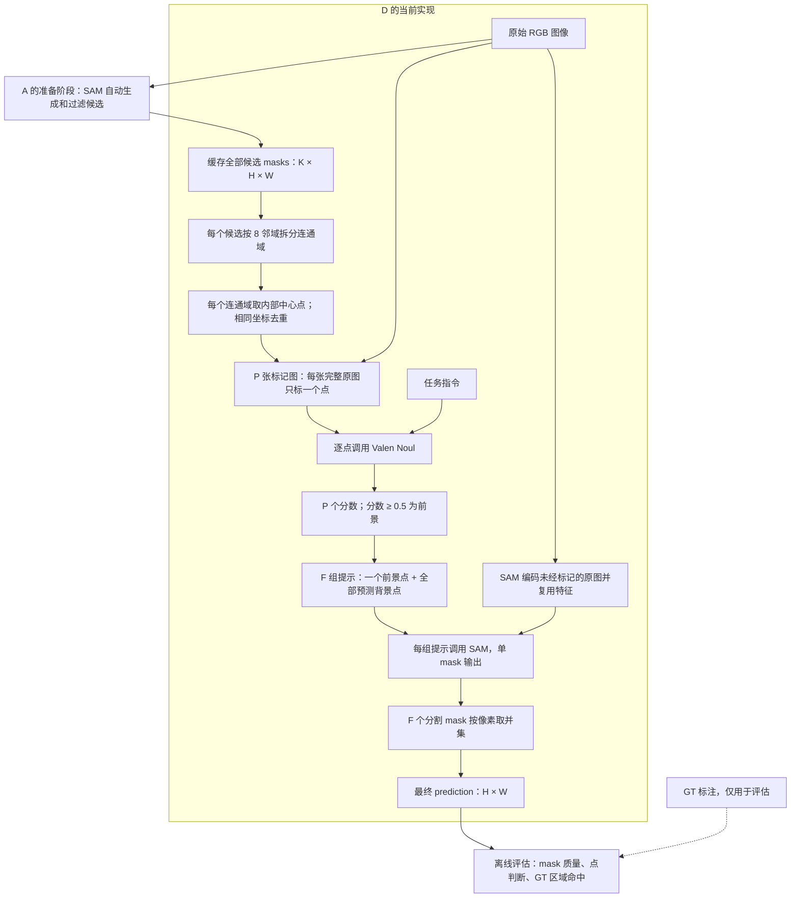

# 方法 D：初版流程、结果诊断与改进

创建日期：2026-10-17。

本文详细记录方法 D 的第一版实现，并作为后续讨论、对照实验和改进的记录入口。总体实验方案见 [04 最小 Affordance 决策测试](04_minimal_affordance_test.md)。

**当前状态：D 初版已完成 5 张图、6 条调试任务的端到端运行；已补做固定点标签的 SAM 对照实验；改进方案尚未合入主程序。** 当前主程序仍使用“连通域内部中心点 → Noul 阈值 0.5 → 每个前景点配合全部背景点 → SAM 单 mask 输出 → 取并集”。

本文分清三类内容：初版流程描述现有代码；结果与对照描述已经运行的实验；改进部分是待验证的假设，不代表当前实现已经改变。

| 入口 | 作用 |
| --- | --- |
| [run_method_d.py](../scripts/run_method_d.py) | D 的命令行入口、模型调用、保存与评估 |
| [method_d_utils.py](../scripts/method_d_utils.py) | 连通域中心点、标记图、SAM 点提示、点级评估 |
| [run_method_a.py](../scripts/run_method_a.py) | A 的候选准备，以及 D 复用的请求、配置等工具 |
| [method_a_utils.py](../scripts/method_a_utils.py) | D 复用的 Noul 解析、mask 合并与像素评估 |
| [umd_debug.json](../configs/umd_debug.json) | 最初的调试样本清单 |
| [D 运行配置](../outputs/method_d_debug/run.json) | 本次实际模型 revision、设备、精度与参数 |

## 1. 初版要解决什么问题

输入一张图片和一条任务指令，输出与原图同尺寸的二值 mask，覆盖指令要求的交互部位。任务可以对应一个区域，也可以对应多个分离区域。

D 使用自动分割候选来安排采样点，再通过点判断传递指令信息。一个点被接受，只说明模型认为该位置符合任务，不能据此接受整个原始候选。因此，初版会用预测前景点重新提示 SAM。

当前程序依赖 A 已准备好的候选目录。**D 复用的是 A 的全部候选，不是 A 的 Valen 判断后接受的候选。** A 只需完成 `prepare` 阶段，D 就可以继续运行。

## 2. 初版流程图



没有可用点或没有预测前景点时，直接得到全零的最终 mask，并记录原因；图中这两条空预测分支为简洁起见未展开。

不支持 Mermaid 的阅读器可以看下面的文本流程：

```text
A 缓存的全部候选 mask
    → 拆分连通域
    → 每个连通域取内部中心点并去重
    → 每点生成一张完整原图上的标记图
    → 标记图 + 指令 → Valen → 点分数与预测标签
    → 每个预测前景点 + 全部预测背景点
    → 使用未经标记的原图提示 SAM，逐次得到单 mask
    → 全部 mask 取并集
    → 保存预测后，读取 GT 并评估
```

## 3. 输入、符号与核心中间变量

记图像高度为 `H`、宽度为 `W`，自动候选数为 `K`，所有候选的连通域总数为 `L`，坐标去重后的点数为 `P`，预测前景点数为 `F`。预测背景点数是 `P - F`。

`P` 由连通域数量决定，不固定为 32，也不等于 `K`。不同候选产生相同坐标时会去重，所以 `P ≤ L`。

| 变量 | 类型或形状 | 含义 |
| --- | --- | --- |
| `a_config` | 字典 | A 的运行配置，包括候选参数与阈值 |
| `manifest` | 字典 | 当次样本清单，每条任务包含图片、指令等 |
| `row` | 字典 | 当前任务，含 `id`、`image`、`instruction`、`candidate_key` 等 |
| `config` | 字典 | 本次 D 的模型、提示模板、取点和分割配置 |
| `rgb` | `uint8[H, W, 3]` | 原始 RGB 图像 |
| 准备阶段的 `masks` / 任务阶段的 `candidates` | `bool[K, H, W]` | 从 A 复用的全部候选 |
| `components` | `int32[K, H, W]` | 每个候选的连通域编号图，0 为候选外的像素 |
| `points` | 长度为 `P` 的列表 | 点 ID、整数坐标和来源映射 |
| `point_sets` | 以 `candidate_key` 为键的字典 | 按图片缓存点集、数量和取点耗时 |
| `records` | 长度为 `P` 的列表 | 每点的请求、响应、Noul 分数、判断和耗时 |
| `scores` | 长度为 `P` 的浮点列表 | 每点的 Noul true 分数 |
| `prompts` | 长度为 `F` 的列表 | 每个预测前景点对应的一组 SAM 提示 |
| `coords` | `float32[1 + P - F, 2]` | 当前前景点和全部背景点的原图坐标 |
| `point_labels` | `int32[1 + P - F]` | 对应提示标签，首项为 1，其余为 0 |
| SAM 返回的 `masks` | `(1, H, W)` | 当前一次提示的单 mask 输出；代码复用了变量名 |
| `quality` | `(1,)` | SAM 对该 mask 的质量预测 |
| `segmentations` | 长度为 `F` 的列表，每项 `bool[H, W]` | 每次 SAM 分割的 mask，包括可能为空的 mask |
| `prediction` | `bool[H, W]` | 最终合并结果 |
| `metrics` / `point_metrics` | 字典 | 最终 mask 的评估和点级评估 |

坐标统一使用原图像素单位：保存及传给 SAM 时是 `[x, y]`，访问 NumPy 图像或标签数组时是 `[y, x]`。它们不是归一化到 0～1 的坐标。

## 4. 初版逐步实现

### 4.1 读取配置，确定本次任务

当前命令行参数只有 `--a-run`、`--output` 和 `--device`，默认分别为 `outputs/method_a_debug`、`outputs/method_d_debug`、`cuda:1`。

程序首先读取 A 输出目录下的 `run.json` 和 `manifest.json`，检查 `method == 'A'`、`prepared == true`，并核对本地模型的验证记录与 revision。当前随机种子为 0。

`config['threshold']` 继承 `a_config['threshold']`，本次为 0.5；D 当前没有单独的 `--threshold` 参数。D 也不会重新读取最新的 `configs/umd_debug.json`，因此修改原始清单后，已有 A 输出中的清单不会自动变化。

GT 路径 `label` 和类别 `target_label` 用于最后的评估。通过 A 准备清单时，这两个字段可以同时省略，以便仅生成预测。

输出目录必须是新目录，已存在时程序报错，以免覆盖旧实验。随后保存本次 `manifest.json` 和 `run.json`。

### 4.2 复用每张图片的全部候选

`candidate_key` 是 A 根据图像 SHA-256 前 16 位生成的键。D 按这个键去重处理图片，并检查当前图像内容是否与 A 运行时一致。

程序复制 `A输出/candidates/<key>/`，从其中读取：

```python
masks = archive['masks']  # masks.npz，bool[K, H, W]
rgb = np.array(Image.open(directory / 'original.png').convert('RGB'))
```

候选可能重叠、嵌套，且一个候选可以包含多个连通域。复制目录也会保留 A 的高亮图等文件，但 D 的 Valen 判断使用后续生成的点标记图。

本次候选来自 SAM 2.1 small。主要上游配置为每边 32 个自动采样点、1 层 crop、预测 IoU 阈值 0.8、稳定性阈值 0.95、`min_mask_region_area=0`；候选过滤去掉空 mask 和 IoU 不低于 0.90 的重复候选，最多保留 24 个。超出上限时按面积排序分组保留，以覆盖不同大小的候选。完整参数以 [A 运行配置](../outputs/method_a_debug/run.json) 为准。

这里没有再次执行自动候选生成，也没有读取 A 的 `selected_ids`。

### 4.3 拆分连通域，计算内部中心点并去重

调用 `component_centers(masks)`。对每个候选：

1. 用 `scipy.ndimage.label` 和全 1 的 `3 × 3` 邻域结构做 8 邻域连通域标记。
2. 对一个连通域，取得全部像素坐标 `xs`、`ys`，计算均值 `cx = xs.mean()`、`cy = ys.mean()`。
3. 在该连通域内，找到使 `(x - cx)² + (y - cy)²` 最小的实际像素。
4. 若有多个像素距离相同，按行、列顺序选择第一个。
5. 用整数坐标 `(x, y)` 查重。完全相同的坐标保留为一个点，但追加所有来源信息。

这样选出来的点一定在来源连通域内，适用于几何中心落在背景上的凹形、环形区域。这里使用的是“离几何中心最近的内部像素”，没有计算距离边界最远点，也没有使用 bbox 中心。

点 ID 和候选 ID 从 0 开始；每个候选内部的连通域编号从 1 开始，不是跨候选的全局编号。一个点可以有多个来源。

下面是刀刃样本中的实际点，几何中心小数做了截断展示：

```json
{
  "id": 5,
  "xy": [289, 202],
  "sources": [
    {
      "candidate_id": 5,
      "component_id": 1,
      "area": 2336,
      "centroid_xy": [289.0261, 202.1712]
    }
  ]
}
```

保存 `components.npz` 和 `points.json`，并在 `point_sets[key]` 中记录点集、连通域数、点数、耗时和来源 mask 文件哈希。同图换指令时，这些内容全部复用。

**初版没有额外过滤微小连通域，没有最小点间距规则，也没有固定点数上限。** 例如本次勺子图的 16 个候选产生了 35 个连通域和 35 个点。

### 4.4 每个点生成一张标记图

`mark_point(rgb, xy)` 复制完整原图，只围绕当前点画一个空心标记：青色圆环半径 5 像素、线宽 2 像素，外侧黑色边框半径 6 像素。中心像素保持原样；图像边缘处的标记会被画布裁切。

每个点保存为 `point_XXX.png`，另保存点图总览 `points.jpg`。每张输入图只标一个点，不把全部点同时画上，也不裁剪为局部图片。

### 4.5 加载模型，逐点执行 Valen 判断

程序加载本地 SAM 2.1 small 和 Valen-4B，分别预热并记录加载、预热耗时。GPU 上 SAM 使用 bfloat16 autocast；Valen 主干使用 bfloat16，决策头保留 float32，使用 `sdpa`、`execution='shared_state'`、`temperature=1.0`。

对每条任务，依次遍历 `P` 个点。每次通过复用的 `request_for()` 构造请求，实际输入为“完整点标记图 + 当前任务指令 + 固定判断说明”。Valen 不单独接收坐标数组，也不接收候选 mask 数组。

当前英文提示模板为：

```text
Task: {instruction}
The center of the small cyan ring marks one image pixel. Judge the original surface at the center, not the ring itself. Other points may also be valid. Being on the right object is insufficient: the point must lie on the functional part requested by the task.
```

Noul 问题为：

```text
Does the pixel at the center of the cyan ring belong to a functional part requested by the task?
```

请求结构中保留了来自 A 的问题键名 `region`，在 D 中它对应的是上述点问题：

```python
request = {
    'state': {'messages': [{'role': 'user', 'content': [
        {'type': 'text', 'text': config['prompt'].format(instruction=instruction)},
        {'type': 'image_url', 'image_url': {'url': str(marked_image_path)}}
    ]}]},
    'questions': {'region': {'type': 'noul', 'instructions': config['question']}}
}
response = model.predict(request, execution='shared_state', temperature=1.0)
score = read_noul(response)  # response['answers']['region']['noul']
accepted = score >= config['threshold']
```

`read_noul()` 检查响应类型及分数是否为 0～1 的有限数。每个点独立判断，多个点可以同时被接受；全部点的分数不要求相加等于 1。

每个点保存一条 `record`，包含 `point_id`、`xy`、`sources`、`noul`、`accepted`、`seconds`、完整 `request` 和 `response`。随后构造 `scores = [r['noul'] for r in records]`。

同图不同指令需要重新执行这一步。它们共享点坐标，但不共享点的预测标签。当前没有将多个点的判断合并成一次模型请求。

### 4.6 为每个前景点构造 SAM 提示

调用 `sam_point_prompts(points, scores, threshold)`，先把点分为：

```python
positives = [i for i, score in enumerate(scores) if score >= threshold]
negatives = [i for i, score in enumerate(scores) if score < threshold]
```

这里的标签全部来自 Valen 的预测。当前没有“不确定”类别：低于阈值的每个点都会进入背景点集合。

对每个预测前景点，构造“该前景点 + 全部预测背景点”。其他预测前景点不参与这次提示，也不会被改成背景点。例如：

```text
预测前景：p2、p5
预测背景：p0、p1、p3

第 1 次提示：coords = [p2, p0, p1, p3]，labels = [1, 0, 0, 0]
第 2 次提示：coords = [p5, p0, p1, p3]，labels = [1, 0, 0, 0]
```

`prompts` 的每一项为 `(point_id, coords, point_labels)`。有 `F` 个预测前景点就构造 `F` 组提示，每组包含 `1 + P - F` 个点。

如果所有点都被预测为前景，每次提示只有一个正点；如果没有前景点，就没有任务分割调用。程序启动时的 SAM 预热调用单独记录，不属于这里的调用数。

### 4.7 给 SAM 原图，逐个前景点重新分割

有可用提示时，使用未经标记的原图调用 `predictor.set_image(rgb)`。图像特征保存在 `predictor` 内，同图的所有提示复用这份特征。

`embedding_key` 记录当前已编码的图片。连续处理同图的不同指令时也可复用；它不是保存全部图片特征的字典，换图后再回来仍需要重新编码。

随后逐次调用：

```python
masks, quality, _ = predictor.predict(
    point_coords=coords,
    point_labels=point_labels,
    multimask_output=False,
)
mask = masks[0].astype(bool)
segmentations.append(mask)
```

每次得到一个与原图同尺寸的 mask，并保存为 `segment_point_XXX.png`。另在 `segmentation_records` 中记录点 ID、全部提示坐标和标签、`quality[0]`、mask 面积及调用耗时。

初版有四个明确边界：

- SAM 接收原图和坐标、标签，不接收自然语言指令，也不接收 Valen 看到的标记图。
- 原始候选只参与取点，没有作为 SAM 的 mask 输入、box 提示或最终边界约束；新分割可以超出原候选。
- `multimask_output=False`，且建模时 `apply_postprocessing=False`。
- SAM 的 `quality` 仅被保存，没有作为额外接受阈值；它也不是与 GT 计算得到的实际 IoU。

### 4.8 按像素取并集，得到最终预测

将 `segmentations` 中的全部 mask 做逻辑 OR，等价于：

```python
prediction = np.zeros((H, W), dtype=bool)
for mask in segmentations:
    prediction |= mask
```

实际代码复用 `merge_masks(segmentations, [1.0] * len(segmentations), 0.5, shape)`。这里传入的全 1 分数只是让所有分割结果参与合并，不是再次做 Noul 判断。

重叠像素只计一次；分离区域全部保留，不只保留最大的连通域。保存成 `prediction.png` 时，前景为 255、背景为 0。

空结果通过 `empty_reason` 区分：

| 值 | 含义 |
| --- | --- |
| `no_points` | 没有可用采样点 |
| `no_positive_points` | 有点，但没有点达到 Noul 阈值 |
| `sam_returned_empty` | 有预测前景点，但全部 SAM 结果合并后仍为空 |
| `null` | 合并结果非空 |

初版不会强制把最高分点变成前景，也不会在空结果时回退为原始候选。

### 4.9 预测完成后读取 GT，评估并汇总

有标注时，直到此处才打开 `.mat` 文件中的 `gt_label`：

```python
labels = loadmat(label_path)['gt_label']
valid = labels >= 0
target = (labels == target_label) & valid
```

当前把负数标签像素排除于评估，这是调试约定；Clutter 的正式有效像素规则仍需核实。GT 不参与候选生成、取点、Valen 判断或 SAM 提示。

评估包括两部分：

- `metrics`：最终 IoU、像素精确率、召回率、TP/FP/FN、GT 像素数、忽略像素数，以及原始候选覆盖率和最佳单候选 IoU。
- `point_metrics`：点级 TP/FP/TN/FN、忽略点数、GT 连通域数、全部采样点和预测前景点分别命中的 GT 连通域数。

点命中只表示至少一个点落在该 GT 连通域内，不表示后续分割完整覆盖了它。原始候选覆盖率也不是 D 最终召回率的硬上限，因为 D 会重新分割。

当前像素评估函数将无预测像素时的 precision 定义为 1。如果直接平均各任务 precision，空预测会抬高均值；分析时应同时报告空预测数量和汇总像素计数。

## 5. 实际例子：刀刃切割任务

以 [knife_cut 的完整记录](../outputs/method_d_debug/samples/knife_cut/scores.json) 为例：

```text
输入图像：H = 480，W = 640
任务：Find all parts used to cut other objects.
GT 目标类别：2，仅用于最后评估

候选 masks：bool[11, 480, 640]
    ↓
连通域 components：int32[11, 480, 640]
连通域总数 L = 11，去重后 P = 11
    ↓
11 张点标记图，11 次 Valen 判断
    ↓
点 #5：[289, 202]，Noul ≈ 0.9472 → 预测前景
点 #9：[406, 268]，Noul ≈ 0.7604 → 预测前景
其余 9 个点 → 预测背景
    ↓
第 1 组：#5 + 9 个背景点，coords.shape = (10, 2)
第 2 组：#9 + 9 个背景点，coords.shape = (10, 2)
两组 point_labels 都为 [1, 0, 0, 0, 0, 0, 0, 0, 0, 0]
    ↓
SAM 第 1 次输出：1133 个前景像素，quality ≈ 0.5117
SAM 第 2 次输出： 105 个前景像素，quality ≈ 0.3633
    ↓
两个 mask 取并集，本例没有重叠：1238 个前景像素
    ↓
最终 prediction.shape = (480, 640)
与 GT 比较：IoU ≈ 0.4905
```

第二个 mask 的 SAM 质量分低于 0.5，但仍被合并，因为 0.5 是本次 Noul 的点接受阈值，当前并未对 SAM 质量分设阈值。“预测前景”也不意味着真实前景；GT 检查表明本例 #9 位于刀柄，属于点判断错误。

## 6. 输出文件与复现方式

### 6.1 输出目录

```text
outputs/method_d_debug/
├── run.json                         # D 配置、模型版本、加载和预热耗时
├── manifest.json                    # 从 A 继承的当次样本清单
├── candidates/<candidate_key>/      # 按图片保存，同图不同任务共享
│   ├── original.png
│   ├── masks.npz                    # A 的全部候选
│   ├── metadata.json                # A 的候选元数据和生成耗时
│   ├── mask_XXX.png                 # A 的逐候选 mask
│   ├── components.npz               # 各候选的连通域编号图
│   ├── points.json                  # 点坐标、来源、数量和耗时
│   ├── point_XXX.png                # 实际给 Valen 的单点标记图
│   └── points.jpg                   # 点图总览
├── samples/<sample_id>/             # 按“图像 + 指令”保存
│   ├── response_XXX.json            # 每点请求、原始响应与判断
│   ├── segment_point_XXX.png        # 每个预测前景点的 SAM mask
│   ├── segmentations.json           # SAM 提示、质量分、面积、耗时
│   ├── prediction.png              # 最终二值 mask
│   ├── scores.json                  # 任务汇总和全部点记录
│   ├── scores.jpg                   # 带分数的点图总览
│   ├── evaluation.json              # 有 GT 时保存
│   ├── ground_truth.png             # 有 GT 时保存
│   ├── valid_pixels.png             # 有 GT 时保存
│   └── comparison.png               # 原图、预测、可选 GT 对照
├── summary.json
├── summary.csv
└── overview.jpg
```

候选目录还包含随 A 目录复制过来的高亮图等文件，上面没有逐项列出。运行日志不是 D 自动创建的，而是运行命令通过输出重定向保存到 [method_d_debug.log](../outputs/method_d_debug.log)。

### 6.2 运行示例

在仓库根目录执行。若复用现有 A 候选，并重新运行 D，需要选择一个尚不存在的输出目录：

```bash
.venv/bin/python -u scripts/run_method_d.py \
  --a-run outputs/method_a_debug \
  --output outputs/method_d_debug_rerun \
  --device cuda:1
```

如果更换清单，需要先准备新的 A 候选目录；例如：

```bash
.venv/bin/python -u scripts/run_method_a.py \
  --manifest configs/umd_debug.json \
  --stage prepare \
  --output outputs/method_a_prepare_rerun \
  --device cuda:1

.venv/bin/python -u scripts/run_method_d.py \
  --a-run outputs/method_a_prepare_rerun \
  --output outputs/method_d_from_prepare_rerun \
  --device cuda:1
```

以上是复现命令示例，新增本文时没有重新运行实验。数据、模型和 `outputs/` 被 Git 忽略；本文的结果链接指向本机已有产物，其他 checkout 需要自行准备或复制这些资源。

## 7. 首轮结果揭示的问题

本轮清单为 5 张图片、6 条任务，包括同一张刀图的抓握与切割任务。它是调试集，未完成计划中的 20 条固定检查样本评估。

### 7.1 逐任务结果

| 任务 | 候选数 K | 点数 P | 预测前景数 F | 采样点命中的 GT 连通域 / 总数 | A IoU | D IoU |
| --- | ---: | ---: | ---: | ---: | ---: | ---: |
| 刀柄抓握 | 11 | 11 | 1 | 1 / 1 | 0.0173 | 0.0645 |
| 刀刃切割 | 11 | 11 | 2 | 1 / 1 | 0.0238 | 0.4905 |
| 杯柄抓握 | 12 | 12 | 0 | 0 / 1 | 0.0000 | 0.0000 |
| 勺子舀取 | 16 | 35 | 2 | 1 / 1 | 0.0257 | 0.0477 |
| 锤头敲击 | 10 | 20 | 1 | 0 / 1 | 0.0005 | 0.0000 |
| Clutter 抓握 | 7 | 22 | 9 | 1 / 3 | 0.1528 | 0.1423 |
| 合计 / 平均 | — | 111 | 15 | 4 / 8 | 0.0367 | 0.1242 |

来源：[A 汇总](../outputs/method_a_debug/summary.json)、[D 汇总](../outputs/method_d_debug/summary.json)、[D 可视化总览](../outputs/method_d_debug/overview.jpg)。同一图片的两个任务会分别计入判断数及任务级 GT 连通域统计。

### 7.2 候选覆盖和中心点覆盖是不同问题

刀柄、锤头的全部候选并集分别只覆盖约 6.02%、1.54% 的 GT，说明自动候选阶段就漏掉了大部分目标部位。杯柄候选覆盖率约 97.14%，但中心点没有落到杯柄上，说明“候选包含目标”也不保证“中心点代表目标”。

本次最大候选数只有 16，没有触发 24 个的数量上限。只提高上限，不改变候选生成和取点方式，不会增加本批图片的点覆盖。

### 7.3 点判断正确率必须和采样覆盖一起看

D 的点级计数为 TP=5、FP=10、TN=96、FN=0。5 个真正采到的目标点全部被接受，但总共只命中了 8 个任务级 GT 连通域中的 4 个。不能把这个条件下的前景点召回率当作整个目标区域的召回率。

Clutter 的 8 个误判前景点中，有 6 个来自图像边缘的小连通域，后续 SAM 输出为空。这些点增加了判断和分割调用，却没有直接增加最终前景像素。分析时需要区分点标签错误、无效调用和最终 mask 错误。

### 7.4 指令区分仍然不足

同一个刀柄点 #9，在抓握任务中 Noul 约为 0.6734，在切割任务中约为 0.7604，两次都被接受。这是同图固定点集下的直接证据：当前模型判断尚未稳定地区分“属于工具”与“属于指令指定的功能部位”。

### 7.5 正确点标签之后仍可能分割失败

勺子任务的两个前景点都在目标内，其余点也都被正确判为背景，但最终只得到 120 个前景像素，目标召回率约 4.79%。这使我们能够把一部分问题定位到点提示后的 SAM 分割，而不是继续把全部错误归因于 Valen。

### 7.6 比较 A、D 时需要保留的限制

D 本轮平均 IoU 更高，但约 89% 的平均改善来自刀刃切割这一条任务。D 的 111 次 Valen 判断多于 A 的 67 次；本次记录的判断阶段耗时分别约为 21.15 秒和 11.50 秒，这不是严格受控的吞吐量基准。

D 额外进行了 15 次任务分割调用。自动候选成本复用自 A，`source_generate_seconds` 是原先每张图的成本；同图多任务只应计一次，不能把缓存后的 D 运行时间当作从零开始的完整成本。模型加载、预热、渲染保存及文件复制也应与模型推理区分，现有各阶段计时之和不等于完整进程墙钟时间。

另外，保持 A 的候选和原始分数不变，只把接受阈值从 0.5 改为 0.8 或 0.9，本调试集平均 IoU 分别变为 0.2425、0.2437；但部分任务会变成空预测。这是 [A 阈值敏感性诊断](../outputs/ad_debug_analysis/a_threshold_sensitivity.json)，并未修改 A 基线。默认阈值下的排名不足以证明哪种方法更好。

## 8. 已完成的 SAM 对照实验

为单独观察 D 的最后分割阶段，固定原始图片、点坐标、Valen 分数和点标签，仅改变“是否使用全部预测背景点”和“单 mask / 多候选输出”。没有重新运行 Valen，没有使用 GT 选择分割结果。

多候选版本对每组提示调用 `multimask_output=True`，按 SAM 自己的质量分选择一个 mask，再对不同前景点的结果取并集。它没有把同组的三个解释直接当作三个目标实例合并。

| 任务 | 全部负点 + 单 mask（初版） | 无负点 + 单 mask | 全部负点 + 多候选择优 | 无负点 + 多候选择优 |
| --- | ---: | ---: | ---: | ---: |
| 刀柄抓握 | 0.0645 | 0.0851 | 0.0551 | 0.0533 |
| 刀刃切割 | 0.4905 | 0.5232 | 0.8523 | 0.5113 |
| 杯柄抓握 | 0.0000 | 0.0000 | 0.0000 | 0.0000 |
| 勺子舀取 | 0.0477 | 0.5561 | 0.0931 | 0.5596 |
| 锤头敲击 | 0.0000 | 0.0566 | 0.0004 | 0.0067 |
| Clutter 抓握 | 0.1423 | 0.0226 | 0.0061 | 0.0216 |
| 平均 IoU | 0.1242 | 0.2073 | 0.1678 | 0.1921 |

来源：[诊断脚本](../outputs/ad_debug_analysis/analyze.py)、[完整诊断结果](../outputs/ad_debug_analysis/diagnostics.json)、[诊断日志](../outputs/ad_debug_analysis/analysis.log)。脚本中还包含明确标记为 GT 离线诊断的 A 候选最优组合计算，它与 D 的预测流程分开。六条任务的初版 D mask 均被逐像素复现。

当前证据支持以下判断：

- 勺子对负点配置敏感。去掉负点后，召回率约从 4.79% 升到 99.91%，但精确率只有约 55.64%，仍然包含无关区域。负点全部判断正确，也不保证这组提示能得到所需的部件 mask。
- Clutter 需要抑制扩张。去掉负点的单 mask 版本，预测面积从 4767 像素增到 125999 像素，IoU 显著下降。
- 刀刃对输出选择敏感。保留负点、按 SAM 质量分选择多候选之一，IoU 从约 0.4905 升到 0.8523。但相同改动对 Clutter 不利，不能直接推广。
- 锤头没有采到目标点。无负点版本得到少量 GT 重叠，是扩张结果，不能据此宣称解决了选点问题。

这些实验说明负点和 mask 输出选择值得继续研究，但没有支持“所有任务统一删除负点”或“统一开启多候选就一定更好”。当前 D 主程序仍保持初版设置。

## 9. 后续改进方向：待验证

### 9.1 先提高部件与采样覆盖

需要分别回答两个问题：自动候选有没有提供目标部件附近的结构？取点规则能否从这些结构中采到目标？

候选生成可比较不同自动采样密度、crop 设置或生成质量阈值，观察小部件覆盖与额外成本。取点可比较单中心点和每个连通域内的多个确定性分散点，保留内部点约束和来源映射。改变候选与改变取点应分开做对照。

本轮还暴露了微小碎片产生额外点的问题。可先记录面积、位置、来源候选、重复程度与实际耗时，再试验点预算和冗余抑制。不能仅因面积小就一律删除，因为真实功能部位也可能很小；附近点去重也需要检查是否误合并了相邻的不同部位。

主要观察指标是 GT 连通域命中数、目标内采样点数、点数 P、决策次数，以及最终 IoU。GT 只做事后评价，不能据 GT 决定增加哪些点。

### 9.2 改善任务条件下的点判断

在固定图像和点集上加入更多同图不同指令任务，检查同一点的分数是否按功能变化。可对照当前提示与更明确的功能部位说明，也可研究完整图加局部视图的输入方式；局部视图必须保留足以判断对象和任务的上下文。

分数阈值需要在调试集上统一校准，不能为每条任务看 GT 后单独挑阈值。点级精确率、召回率必须与采样覆盖一起报告。

可探索三态规则：`score >= τ_pos` 为前景，`score <= τ_neg` 为背景，中间区间为不确定，且 `τ_neg < τ_pos`。不确定点不作为 SAM 的强背景约束。这是待实现的规则，当前仍是 0.5 二分。

### 9.3 研究哪些负点应该参与一次分割

目前所有非前景点都被当作强负点，并参与每一次分割。可以对照：全部负点、仅高置信负点、按空间或候选关系筛选负点，以及限制数量的负点集合。

筛选规则应统一、确定且只依赖可用的图像、候选和模型预测。需要同时观察勺子这样的欠分割案例和 Clutter 这样的扩张案例，不能只根据某一张图改善就定方案。

改变点阈值、正负点集合或负点筛选后，必须重新提示 SAM。不能简单从原来保存的分割结果中删掉几个 mask，冒充新提示的输出，因为同一个前景点对应的负点已经变了。

### 9.4 研究 SAM 输出选择和结果质量

已有对照支持继续比较单 mask 与多候选质量择优。进一步可以检查候选是否包含提示正点、是否覆盖提示负点、面积及边界是否异常，并把这些诊断与 SAM 质量分一起保存。

这些一致性检查是否适合作为筛选规则，需要独立验证；低质量结果可能需要拒绝或重试，不能仅凭本轮几个例子选一个 SAM 质量阈值。

若尝试用来源候选提供 box、局部范围或其他约束，应作为新的对照版本记录。原候选本来就可能漏掉部件，直接把新分割与原候选做交集可能限制召回；不能默认来源候选就是正确边界。

### 9.5 保留多个有效区域，控制合并误差

继续保存每个点对应的原始 mask，再进行合并，才能定位哪个提示贡献了真阳性和误选区域。不同前景点分出了同一区域时，并集不会重复计数，但多余模型调用仍会增加成本。

后续若尝试把多个前景点合成一次提示，需要明确这些点是否属于同一交互部位；不能默认所有前景点都应被 SAM 当成一个对象。评估必须包括单区域、多区域及空预测情况，不能通过只保留最大连通域提高部分样本分数。

## 10. 下一轮实验与记录要求

先保留初版结果作为固定参照，再逐项改变规则：

| 顺序 | 固定什么 | 改变什么 | 要回答的问题 |
| --- | --- | --- | --- |
| 1 | 图片和指令 | 候选生成配置；单独一组试验改变取点配置 | 杯柄、锤头和多区域目标能否被采到？ |
| 2 | 候选和点集 | 提示说明、点阈值或三态规则 | 分数是否真正区分任务部位？ |
| 3 | 同一组保存的点分数 | 负点选择规则、SAM 输出选择 | 能否同时减少欠分割和背景扩张？ |
| 4 | 冻结后的整体配置 | 独立检查样本 | 改善是否能在未用于调参的任务上保持？ |

前三类实验各自保留原始对照；不要在同一次比较中同时改动候选、提示、阈值和分割策略。新增 20 条固定检查任务时，按工具实例或场景与调试集分开，并核实标注含义及有效像素规则。

每次至少记录模型 revision、候选和取点配置、点标记方式、完整提示、点阈值、负点选择、SAM 输出选择、设备精度和随机种子。保存逐点分数、前景点数 F、每次提示的全部坐标和标签、各次分割 mask、最终 mask、逐任务指标及各阶段耗时。

当前工作状态：

- [x] 初版 D 的候选复用、取点、判断、分割、合并和评估已实现。
- [x] 同一批 6 条调试任务已完成，保存了完整中间结果。
- [x] 已完成四种 SAM 提示/输出组合的诊断，原 D 输出可逐像素复现。
- [ ] 候选覆盖和多点采样改进尚未实现、验证。
- [ ] 三态判断、负点筛选和新增质量规则尚未实现、验证。
- [ ] 独立的 20 条固定检查任务及冻结配置比较尚未完成。

后续新增实验时，应补充实际配置、结果路径、失败案例及结论适用范围；只有已经运行并确认的改动才更新“当前实现”部分。
