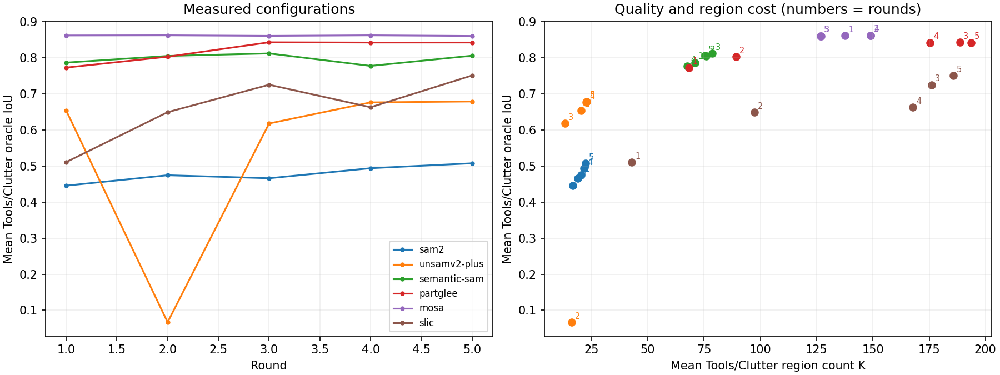

# UMD 720 张人工标注分割评测：采用 MoSA

后续针对 MoSA 的参数搜索见 [08：MoSA 专项调参](08_mosa_parameter_tuning.md)。本报告保留六方法选型阶段的结果与当时决定。

实验日期：2026-10-18 至 2026-10-19。**最终选择 MoSA whole-image R50，停止继续调参。实际完成并验收 5 轮，第 6 轮未完整完成；原计划的 10 轮没有跑满。**

推荐采用第 5 轮的 MoSA 配置：`max_masks=250`、`score_thresh=0.25`、`mask_nms_thresh=0.95`、`min_mask_area=16`。平均 Oracle IoU 为 **0.8609**，平均区域数 **126.6**，分割耗时约 **0.65 秒/图**。

本文是固定开发样本上的参数比较与工程选型记录，不是独立测试集成绩，也不是模型直接预测功能类别的准确率。

## 1. 为什么选择 MoSA？

在五轮完整实验中，MoSA 的质量最高，Tools 和 Clutter 上的表现也接近。选用的第 5 轮配置在保持接近最高质量的同时，减少了区域数和推理开销：

| MoSA 配置 | 来源 | Tools IoU | Clutter IoU | 二者均值 Q | 平均区域数 K | 秒/图 |
|---|---|---:|---:|---:|---:|---:|
| 质量最高：500 个候选、阈值 0.25 | 第 2 轮 | 0.8655 | 0.8596 | 0.8626 | 148.9 | 0.898 |
| **采用：250 个候选、阈值 0.25** | **第 5 轮** | **0.8641** | **0.8576** | **0.8609** | **126.6** | **0.652** |

两者 NMS 阈值均为 0.95，最小区域面积均为 16。采用配置相对质量最高配置，Q 下降 **0.00169**，区域数减少约 **15.0%**，记录到的单图耗时减少约 **27.3%**。这些时间来自本机运行，未做独立重复测速。

这也符合实验开始时规定的折中选择规则：在 Q 距最高值不超过 0.005、0.8 达标率下降不超过 0.02 的配置中，优先选择区域更少的配置。若只追求本次实测最高 Q，可使用保留的 500 候选配置。

## 2. 数据、输入输出与评价口径

本地 UMD 共 29,711 张 RGB/GT 对。逐个读取标签 MAT 的 `gt_type`，确认人工标注共 **9,922 张**：Tools 9,632 张，Clutter 290 张。未通过帧号取余猜测人工标注身份。

固定抽取以下 720 张，所有方法、所有轮次使用完全相同的清单：

| 子集 | 实例/场景数 | 每组样本数 | 合计 |
|---|---:|---:|---:|
| Tools | 105 个工具实例 | 6 | 630 |
| Clutter | 3 个场景 | 30 | 90 |
| 合计 | 108 | — | **720** |

每组人工帧按样本名排序，使用 `floor((i+0.5)*N/k)` 均匀选取不同视角。720 张全部为人工标注，无重复 RGB，覆盖 grasp、cut、scoop、contain、pound、support、wrap-grasp 七类。

清单 SHA-256：`4bbc292f9148b4b88150ea9648f449a3e792d4c3c0ad31ba2679188b2939558d`。

模型只接收 RGB，输出与原图同尺寸的区域编号图。GT 只用于评价和跨轮选择参数；背景参与评价，`-1` 标签按项目约定忽略。分割结果经过统一的解重叠、补齐、连通域拆分和小区域合并。

| 指标 | 本报告中的含义 |
|---|---|
| Oracle IoU | 利用 GT 选择并合并已有区域，能达到的最高 IoU；一个刀柄分成多块时，允许把多块合起来评分 |
| Q | Tools 与 Clutter 的 Oracle IoU 等权平均，作为参数搜索的主要质量分数 |
| 0.8 达标率 | “图片 + 出现的功能类别”的最优组合 IoU 达到 0.8 的比例，再按下述规则宏平均 |
| 区域数 K | 全图最终独立区域数量，包括背景；不等于原始候选上限，也不等于功能类别数 |
| 代表点命中率 | 每个最终区域取一个区域内部代表点后，能命中多少比例的 GT 功能连通区域 |
| 秒/图 | 模型初始化后，从调用分割到得到最终分区的时间；不包含 GT 评价、保存和可视化 |

Tools、Clutter 各自先对同一实例/场景中的帧平均，再对实例/场景平均，最后对出现的功能类别等权平均。K 和耗时不按功能类别重复计数，先按帧、再按实例/场景平均。跨子集的 K、耗时和达标率等汇总值同样采用 Tools/Clutter 等权平均，并非按 630∶90 加权。

运行环境为 GPU 1 上的 NVIDIA GeForce RTX 4090 D（49,140 MiB）、Python 3.10、PyTorch 2.6.0+cu124。学习模型依次加载，每方法每轮只加载一次，处理全部图片后退出；SLIC 使用 CPU。没有单独预热，首张图包含在计时内。完整格式与指标解释见 [06：评价方案](06_umd_affordance_partition_benchmark.md)。

## 3. 六种方法的完整轮次比较

下表为每个方法在**前五轮完整实验中 Q 最高的配置**。它们不一定来自同一轮；“最佳”仅指已测范围内的最高分。MoSA 的工程采用配置见第 1 节。

| 方法 | 最佳轮 | 默认 Q | 最佳 Tools IoU | 最佳 Clutter IoU | 最佳 Q | K | 秒/图 |
|---|---:|---:|---:|---:|---:|---:|---:|
| MoSA | 2 | 0.8622 | 0.8655 | 0.8596 | **0.8626** | 148.9 | 0.898 |
| PartGLEE | 3 | 0.7730 | 0.8489 | 0.8375 | 0.8432 | 188.6 | 0.868 |
| Semantic-SAM | 3 | 0.7869 | 0.8015 | 0.8231 | 0.8123 | 78.5 | 2.958 |
| SLIC | 5 | 0.5108 | 0.7813 | 0.7211 | 0.7512 | 185.7 | 0.187 |
| UnSAMv2+ | 5 | 0.6543 | 0.7272 | 0.6308 | 0.6790 | 22.7 | 5.869 |
| SAM2 | 5 | 0.4456 | 0.5355 | 0.4797 | 0.5076 | 22.2 | 2.655 |

MoSA 的采用配置 Q=0.8609 仍高于其他方法在已测配置中的最高 Q。PartGLEE 能接近 MoSA，但区域更多。Semantic-SAM 的区域较少，但本实验质量较低、分割更慢。SLIC 最快，增加区域数后质量明显改善，仍未达到 MoSA 的水平。

SAM2 的低分主要来自细小深色工具、刀柄等与背景黏在同一区域。对最差样本和普通样本的检查未发现 GT 与图像坐标错位；增加点密度和放宽阈值有帮助，但尚未解决整体差距。



图中每个点是一轮实际配置；右图数字为轮次。它展示已测试配置的质量与区域数关系，不是对所有可能参数的穷尽搜索。

### 各轮 Q 的变化

| 方法 | 第 1 轮 | 第 2 轮 | 第 3 轮 | 第 4 轮 | 第 5 轮 |
|---|---:|---:|---:|---:|---:|
| SAM2 | 0.4456 | 0.4744 | 0.4661 | 0.4939 | 0.5076 |
| UnSAMv2+ | 0.6543 | 0.0667 | 0.6180 | 0.6765 | 0.6790 |
| Semantic-SAM | 0.7869 | 0.8053 | 0.8123 | 0.7777 | 0.8061 |
| PartGLEE | 0.7730 | 0.8032 | 0.8432 | 0.8425 | 0.8426 |
| MoSA | 0.8622 | 0.8626 | 0.8611 | 0.8626 | 0.8609 |
| SLIC | 0.5108 | 0.6493 | 0.7255 | 0.6630 | 0.7512 |

每次从该方法此前最好的完整配置出发，只改变一项参数。较差的试验也保留，没有从报告中删除。逐轮原始数字见 [trajectory.csv](assets/umd720_benchmark/trajectory.csv)。

## 4. 哪些参数有实际影响？

### MoSA

| 轮 | max_masks | score_thresh | mask_nms_thresh | Q | K | 秒/图 | 观察 |
|---|---:|---:|---:|---:|---:|---:|---|
| 1 | 500 | 0.35 | 0.95 | 0.8622 | 137.5 | 0.882 | 默认配置已较好 |
| 2 | 500 | 0.25 | 0.95 | 0.8626 | 148.9 | 0.898 | 本次最高 Q；相对默认只提升 0.00037 |
| 3 | 500 | 0.45 | 0.95 | 0.8611 | 126.9 | 0.848 | 提高分数阈值能减少区域 |
| 4 | 1000 | 0.25 | 0.95 | 0.8626 | 148.9 | 1.319 | 质量和 K 均未改善，时间增加 |
| **5** | **250** | **0.25** | **0.95** | **0.8609** | **126.6** | **0.652** | **采用：质量接近最高值，减少区域与耗时** |

`max_masks` 是全图候选预算，不是最终 K。候选经过阈值筛选、重叠处理与连通域拆分后，最终区域数会变化。当前证据支持优先控制候选预算，而不继续增加到 1000。

第 6 轮中 MoSA 的 720 张已经完成：在第 2 轮配置基础上，把 NMS 阈值改为 0.85，Tools IoU 为 0.8639、Clutter 为 0.8590、Q 为 0.8615。这个结果单独保留为补充记录，因整轮不完整，不进入前五轮的比较表，也不改变最终选型。

### 其他方法

| 方法 | 已观察到的重要参数与结果 |
|---|---|
| SAM2 | 点网格从 32×32 增加到 64×64，Q 从 0.4456 增至 0.4744；继续把预测 IoU 阈值从 0.8 降至 0.6，达到 0.5076，同时更慢 |
| UnSAMv2+ | granularity=0.1 严重退化至 Q=0.0667；0.2 比本次试过的 0.1、0.3 更好；保留 0.2 并把预测 IoU 阈值降至 0.55，达到 0.6790 |
| Semantic-SAM | 预测 IoU 阈值从 0.88 降至 0.7，Q 增至 0.8123；只保留部分层级的两次试验都较差，保留全部六层 |
| PartGLEE | score 阈值从 0.25 降至 0.05，Q 从 0.7730 增至 0.8432，但 K 从 68.4 增至 188.6；改 NMS 阈值未进一步提升 |
| SLIC | n_segments 从 50 增至 200 是主要增益来源；在该配置上 compactness=10 优于 1 和 5，Q 达到 0.7512；最终 K 也增至 185.7 |

这些是特定父配置下的参数变化效果；有限轮次不能证明全局最优，也不能排除参数之间的相互影响。第 8～9 轮原计划探索的小区域合并面积没有执行。

## 5. 最终采用配置的详细表现

MoSA 第 5 轮：

| 子集 | 图像数 | Oracle IoU | 0.8 达标率 | K | 代表点命中率 | 秒/图 |
|---|---:|---:|---:|---:|---:|---:|
| Tools | 630 | 0.8641 | 0.8431 | 109.7 | 0.9294 | 0.639 |
| Clutter | 90 | 0.8576 | 0.8143 | 143.6 | 0.8339 | 0.666 |
| 两子集等权平均 | — | 0.8609 | 0.8287 | 126.6 | 0.8817 | 0.652 |

按功能划分的 Oracle IoU：

| 功能 | Tools | Clutter |
|---|---:|---:|
| grasp 抓握 | 0.7621 | 0.8084 |
| cut 切割 | 0.8514 | 0.8280 |
| scoop 舀取 | 0.8855 | 0.8616 |
| contain 容纳 | 0.9129 | 0.8934 |
| pound 敲击 | 0.8521 | 0.8732 |
| support 支撑 | 0.9041 | 0.9174 |
| wrap-grasp 包握 | 0.8806 | 0.8215 |

grasp 仍是薄弱项。Clutter 的 grasp 代表点命中率约为 0.7044，说明即使整体分区质量较好，后续每区域只取一个点时，仍可能漏掉部分抓握连通区域。选定 MoSA 不代表后续区域判断和选点问题已经解决。

## 6. 使用配置与结果文件

已将 [config.py](../config.py) 的 Python API 默认方法设为 `mosa`，并采用第 5 轮的参数。固定设置为：

```python
DEFAULT_METHOD = 'mosa'
MIN_MASK_AREA = 16
MOSA = {
    'max_masks': 250,
    'score_thresh': 0.25,
    'mask_nms_thresh': 0.95,
}
```

模型使用 whole-image R50 权重；输入短边 1024、长边上限 2048，float32，随机种子 0，`mask_batch_size=16`。这些设置与选中的实测配置一致。

单独运行 MoSA：

```bash
python dense_partition.py --method mosa --image path/to/image.jpg
```

Python 接口：

```python
from dense_partition import DensePartition

with DensePartition.create() as segmenter:  # 默认 MoSA
    result = segmenter.segment('path/to/image.jpg')
labels = result.labels
```

两个比较脚本在不指定 `--method` 时仍按此前约定运行全部六种方法。以上命令供后续使用，本次收尾没有启动新实验。

| 文件 | 内容 |
|---|---|
| [mosa_selected_config.json](assets/umd720_benchmark/mosa_selected_config.json) | 采用的第 5 轮参数覆盖，可传入 benchmark 的 `--config` |
| [mosa_quality_config.json](assets/umd720_benchmark/mosa_quality_config.json) | 第 2 轮质量最高的参数覆盖 |
| [best_method_summary.csv](assets/umd720_benchmark/best_method_summary.csv) | 各方法最佳轮次的 Tools/Clutter 全指标 |
| [trajectory.csv](assets/umd720_benchmark/trajectory.csv) | 前五轮共 30 组方法配置的实测轨迹 |
| [experiment_summary.json](assets/umd720_benchmark/experiment_summary.json) | 样本哈希、停止状态、每轮验收和 MoSA 完整配置快照 |

原始大文件保留在本地 [实验目录](../outputs/umd_full_tuning_20261018_211215_853312/)，未纳入 Git：每轮的 `results.sqlite` 保存全部最终标签和功能评分，CSV 保存汇总与明细，`index.html` 提供 24 张示例对照，配置、选择理由及验收分别保存在 `round_NN_config.json`、`round_NN_decisions.json`、`round_NN_review.json`。可直接打开 [第 5 轮页面](../outputs/umd_full_tuning_20261018_211215_853312/round_05/index.html)。

## 7. 完成情况与结论边界

- 前五轮全部完成：`5×720×6=21,600` 次成功分割。每轮验收会核对任务集合、重建汇总，并从保存的标签重算均匀选取及最差样本的指标。
- 第 6 轮五种方法各完成 720 张，另有 3,600 份成功结果保留；Semantic-SAM 的 720 个任务未得到成功结果，因此整轮没有通过验收。
- Semantic-SAM 增加采样点后，候选数超过 5,000，暴露了上游 NMS 的 CPU 类别索引与 CUDA 张量设备不一致问题。已加入限定在 Semantic-SAM 内的设备适配；68 项测试通过，8 张旧配置标签逐像素一致，8 张原失败配置真实图片验证成功。这些验证不构成新的 benchmark 轮次。用户决定停止后未补跑第 6 轮，也未执行第 7～10 轮。
- 原始结果和 provenance 保持原样，修复后的实现没有被用于改写既有实验成绩。实验停止状态记录于 `stop_requested.json` 和 `controller_state.json`。
- 720 张被反复用于参数选择，且相邻视角存在相关性；没有独立留出实例/场景测试，也没有计算置信区间。小幅分数差异不能解释为已经证明的泛化优势。
- Oracle 使用 GT 选择区域，是分区的表达能力上限；实际功能识别、区域选择与执行成功率需要后续单独评价。

本阶段的工程决定是：**以 MoSA 第 5 轮配置作为后续系统的分区模块，结束本轮方法筛选与参数搜索。**
