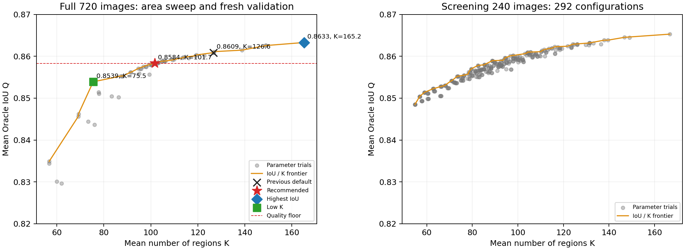
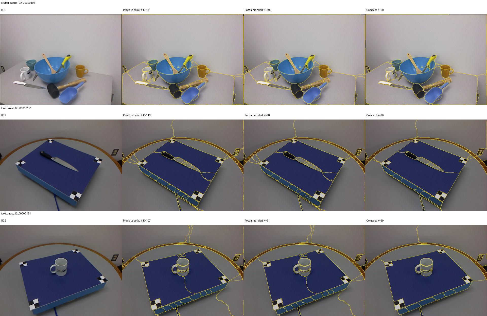

# MoSA 专项调参结果与配置选择

后续更新：[09：进一步降低 K](09_mosa_low_k_tuning.md) 已验证平均 K≈65、60、50 三档；其中 K=59.81、Oracle IoU=0.85147。本文保留上一轮严格质量容差下的选择依据与完整结果。

实验日期：2026-10-19。推荐使用 **250 个候选、分数阈值 0.40、NMS 阈值 0.95、最小区域面积 36**。在固定的 720 张 UMD 开发图片上，平均 Oracle IoU 为 **0.85835**，平均区域数 K 为 **101.73**。相对仓库原默认，K 减少 **19.7%**，IoU 下降 **0.00251**，约 0.25 个百分点。

这里的 IoU 是利用 GT 选择区域并集时的表达能力上限。720 张图片沿用此前调参清单，不是独立测试集；结果用于选择分区模块参数，不代表功能识别准确率或泛化成绩。

| 方案 | max_masks | score_thresh | mask_nms_thresh | min_mask_area | Oracle IoU | K | 0.8 达标率 | 代表点命中率 |
|---|---:|---:|---:|---:|---:|---:|---:|---:|
| 原默认 | 250 | 0.25 | 0.95 | 16 | 0.86086 | 126.64 | 0.82870 | 0.88166 |
| 本次质量最高 | 500 | 0.15 | 0.95 | 16 | **0.86329** | 165.23 | 0.83711 | 0.88333 |
| **推荐折中** | **250** | **0.40** | **0.95** | **36** | **0.85835** | **101.73** | **0.81766** | **0.88009** |
| 更保守的折中 | 250 | 0.40 | 0.95 | 32 | 0.85882 | 104.72 | 0.82004 | 0.88007 |
| 低 K 备选 | 250 | 0.65 | 0.75 | 48 | 0.85390 | **75.49** | 0.79521 | 0.87677 |

选择规则沿用此前实验：相对已测最高 IoU，允许 Q 下降不超过 0.005、0.8 达标率下降不超过 0.02，在满足条件的配置中选 K 最小者。本次对应 Q ≥ 0.858286、达标率 ≥ 0.817107。最小面积 36 满足条件；相邻试验值 38 的 Q 为 0.858167，已越过质量容差。36 接近规则边界，若希望多留一些质量余量，可以采用表中的面积 32 配置。

低 K 备选比原默认减少 **40.4%** 的区域，IoU 下降约 0.70 个百分点，0.8 达标率下降约 3.35 个百分点，适合更看重后续区域判断成本的场景。它不满足上述严格折中规则，因此单独保留。



左图使用完整 720 张结果，右图使用筛选用的 240 张结果，两图的分数不能直接混合排名。图中展示 Q ≥ 0.82 的配置；完整数据保存在 CSV 中。橙线表示各自候选集合中的 IoU 与 K 前沿，红色虚线为本次质量容差下限。

推荐配置在 Tools 上的 IoU 为 **0.86192**、K 为 **91.96**、代表点命中率为 **0.92926**；在 Clutter 上分别为 **0.85479**、**111.49**、**0.83092**。最终汇总对 Tools 和 Clutter 等权。每个子集内部仍按帧、实例或场景、功能类别逐级平均，背景参与 IoU 计算，忽略标签为 -1。

本次实验只调整 MoSA，固定 whole-image R50 权重、短边 1024、长边上限 2048、float32 和随机种子 0。面积阈值的单位是原图像素。完整过程如下：

1. **56 组全量后处理回放**：复用已保存的分区，在全部 720 张上比较面积阈值。覆盖 16 至 512 的粗扫，以及 20 至 56、32 至 64 的局部细扫。原始四组基准共 4×720 张的质量指标全部复现一致。
2. **292 组候选参数筛选**：从每个 Tools 实例固定选 2 张、每个 Clutter 场景选 10 张，共 210+30=240 张。主要网格为候选数 `{100,150,200,250,350,500}`、分数 `{0.25,0.40,0.55,0.65}`、NMS `{0.75,0.85,0.95}`、面积 `{16,24,32,48}`，另补充 4 组分数 0.15 的配置。
3. **5 组完整真实推理**：每组跑全部 720 张，共 3,600 个成功结果，无失败样本。包含面积 32 的基准复核、500/0.45/0.95/40，以及高质量、初选折中和低 K 三档。全部保存最终标签、逐图指标和可视化示例。
4. **最终面积细调验证**：推荐的面积 36 来自初选折中配置完整推理后的标签合并回放，全部 720 张重新计算指标。另选 24 个均匀位置及 8 个低分样本，去重后 31 张，使用真实模型从未合并分区直接处理；8 个面积阈值共 248 次标签比较逐像素一致。

候选缓存保留全部 500 个 query，包括空 Mask，确保空候选仍占用 top-k 的排序位置。缓存筛选的两个基准配置在全部 240 张上，K、IoU、达标率和代表点命中率均与历史真实推理结果一致。最终筛选配置再用正常 benchmark 入口完成真实推理，避免仅依赖缓存中的候选排序。

五组真实推理都通过了 720 张分区契约检查、35 张均匀及低分样本的指标重算、全部汇总重建。面积 32 和 40 的两组复跑还与历史标签回放逐像素比较，均为 720/720 一致。代码测试共 **70 项通过**。部分完整验证任务在同一 GPU 上并行，因此本报告不使用这些时间比较速度。



三档配置以仅覆盖 MoSA 的 JSON 保存，仓库 `config.py` 仍保留原默认。这样可以单独采用 MoSA 的面积参数，不影响其他方法共用的 `MIN_MASK_AREA`。

| 文件 | 用途 |
|---|---|
| [selected_config.json](assets/mosa_tuning_20261019/selected_config.json) | 推荐折中，250 / 0.40 / 0.95 / 36 |
| [quality_config.json](assets/mosa_tuning_20261019/quality_config.json) | 本次最高 IoU，500 / 0.15 / 0.95 / 16 |
| [compact_config.json](assets/mosa_tuning_20261019/compact_config.json) | 低 K 备选，250 / 0.65 / 0.75 / 48 |
| [full_comparison.csv](assets/mosa_tuning_20261019/full_comparison.csv) | 基准与完整验证结果，标明真实推理或标签回放 |
| [area_sweep.csv](assets/mosa_tuning_20261019/area_sweep.csv) | 56 组面积回放结果 |
| [screening.csv](assets/mosa_tuning_20261019/screening.csv) | 292 组筛选结果 |
| [selected_per_class.csv](assets/mosa_tuning_20261019/selected_per_class.csv) | 推荐配置的分功能指标 |
| [experiment_summary.json](assets/mosa_tuning_20261019/experiment_summary.json) | 选择规则、完整数值、样本哈希及验证记录 |

使用推荐配置运行评测：

```bash
conda activate systemone-affordance
unset PYTHONPATH
python affordance_benchmark.py \
  --manifest outputs/umd_full_tuning_20261018_211215_853312/manifest_sample720_umd.json \
  --method mosa --streaming \
  --config docs/assets/mosa_tuning_20261019/selected_config.json
```

在 Python 中对普通图片使用推荐参数：

```python
import json
from pathlib import Path
from config import get_config
from dense_partition import DensePartition

overrides = json.loads(Path(
    'docs/assets/mosa_tuning_20261019/selected_config.json'
).read_text())['mosa']
settings = get_config('mosa')
for section, values in overrides.items():
    settings[section].update(values)
with DensePartition.create('mosa', config=settings) as model:
    result = model.segment('your_image.jpg')
```

本地原始记录保存在 [实验目录](../outputs/mosa_tuning_20261019/)：`full_*` 保存五组真实推理的 SQLite 和交互页面，`area*` 保存后处理回放指标，`screen_exact` 保存筛选结果，`raw_cache` 保存未过滤候选，`logs`、`code_snapshot` 和各审计 JSON 保留复核依据。推荐配置的全量逐图指标位于 `area_final/`，其推理来源是 `full_balanced/`。

复现筛选可使用新增的 [缓存脚本](../scripts/cache_mosa_proposals.py) 和 [调参脚本](../scripts/tune_mosa.py)，在仓库根目录以 `python -m scripts.cache_mosa_proposals --help`、`python -m scripts.tune_mosa --help` 查看参数。候选筛选使用 `--cache-source` 指向保留空 query 的缓存；正式验证使用上面的标准 benchmark 入口。
