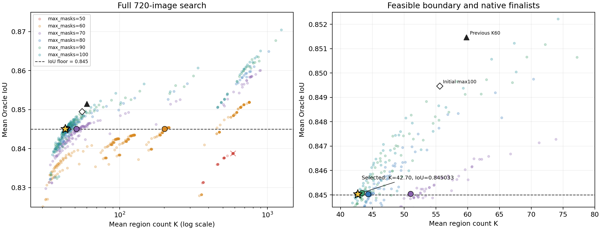
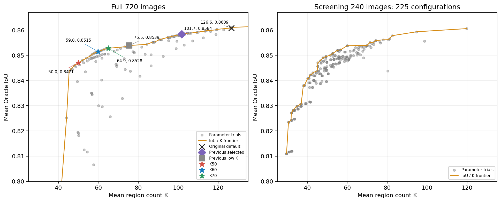

# MoSA 低 K 调参：Oracle IoU ≥ 0.845

实验日期：2026-10-19。按最新目标，在 **Oracle IoU ≥ 0.845** 的配置中选择平均区域数 **K 最小**者，并联合调整 `max_masks={50,60,70,80,90,100}`、分数阈值、NMS 和最小区域面积。

本轮推荐 **max_masks=100、score_thresh=0.89、mask_nms_thresh=0.85、min_mask_area=121**。在同一份 720 张 UMD 开发图片上，真实推理得到 **Oracle IoU=0.84503289、平均 K=42.6968**。相对刚追加的 100 / 0.85 / 0.95 / 52 配置，K 减少 **23.20%**；相对此前 K≈60 的推荐档，K 减少 **28.61%**。

历史结果、单参数追加实验及本轮六档结果统一放在下表。六档新结果均来自正常 benchmark 入口的完整真实推理，每档 **720/720 成功，0 推理失败**；最后五档满足本轮质量门槛。选择使用未四舍五入的 IoU，表内显示五位小数。

| 方案 | max_masks | score_thresh | NMS | 最小面积 | Oracle IoU | 平均 K | IoU ≥ 0.8 达标率 | 代表点命中率 |
|---|---:|---:|---:|---:|---:|---:|---:|---:|
| 原默认 | 250 | 0.25 | 0.95 | 16 | 0.86086 | 126.64 | 0.82870 | 0.88166 |
| 上一轮严格折中 | 250 | 0.40 | 0.95 | 36 | 0.85835 | 101.73 | 0.81766 | 0.88009 |
| 上一轮低 K | 250 | 0.65 | 0.75 | 48 | 0.85390 | 75.49 | 0.79521 | 0.87677 |
| 此前 K ≤ 70 | 150 | 0.85 | 0.95 | 32 | 0.85280 | 64.94 | 0.79262 | 0.87162 |
| 此前 K ≤ 60 | 150 | 0.85 | 0.95 | 52 | 0.85147 | 59.81 | 0.78504 | 0.87096 |
| 此前 K ≤ 50 | 150 | 0.85 | 0.95 | 128 | 0.84708 | 49.98 | 0.76295 | 0.86967 |
| 100 候选初始对照 | 100 | 0.85 | 0.95 | 52 | 0.84947 | 55.60 | 0.78130 | 0.86850 |
| [50 候选：最高已测 IoU，未达标](assets/mosa_q0845_20261019/max_masks50_config.json) | 50 | 0.86 | 1 | 0 | 0.83878 | 584.20 | 0.76869 | 0.89737 |
| [60 候选：最低已测达标 K](assets/mosa_q0845_20261019/max_masks60_config.json) | 60 | 0.875 | 0.95 | 2 | 0.84505 | 201.16 | 0.78188 | 0.87623 |
| [70 候选：最低已测达标 K](assets/mosa_q0845_20261019/max_masks70_config.json) | 70 | 0.89 | 0.95 | 23 | 0.84504 | 51.00 | 0.77160 | 0.86150 |
| [80 候选：最低已测达标 K](assets/mosa_q0845_20261019/max_masks80_config.json) | 80 | 0.9 | 0.95 | 75 | 0.84503 | 44.36 | 0.76228 | 0.86204 |
| [90 候选：最低已测达标 K](assets/mosa_q0845_20261019/max_masks90_config.json) | 90 | 0.9 | 0.95 | 102 | 0.84508 | 43.38 | 0.75968 | 0.86469 |
| **[100 候选：本轮推荐](assets/mosa_q0845_20261019/max_masks100_config.json)** | 100 | 0.89 | 0.85 | 121 | 0.84503 | 42.70 | 0.76354 | 0.86585 |

50 候选最高已测 IoU 为 **0.83878**，没有达标配置。该行展示的是最高 IoU 配置，不能作为满足约束的低 K 解。60 候选虽然达标，但必须保留很多细小区域，K 仍超过 200；`max_masks` 限制的是原始候选数，最终连通分区的 K 可以更大。本轮最小 K 来自 100 候选。

推荐配置的 Tools IoU 为 **0.84655**，Clutter IoU 为 **0.84352**；0.8 达标率为 **0.76354**，代表点命中率为 **0.86585**。本次 0.845 门槛约束的是两个子集等权汇总的 Oracle IoU，达标率和代表点命中率作为附加指标报告。全部 720 张的 K 中位数为 **43**，P90 为 **49**，最大值为 **58**；这些分布统计不采用子集等权。

固定推荐档的 generator 参数时，面积 **122** 的全量回放 IoU 为 **0.8449990053**，已低于 0.845，因此选择面积 **121**。这也说明门槛判断必须使用未四舍五入的数值。



图中均为完整 720 张结果，显示 IoU ≥ 0.825 的配置；左图 K 采用对数轴，以包含未合并时的大量碎片，右图放大质量门槛附近。圆点及叉号标出六档真实推理结果，星号为推荐配置；三角形和空心菱形分别为此前 K≈60 档及 100 候选初始对照。240 张筛选结果单独保存，不与全量分数混合选择。

本轮搜索与复核：

1. **1,260 组粗筛 × 240 张**：候选数 {50,60,70,80,90,100}，分数 {0,0.65,0.75,0.85,0.90,0.95}，NMS {0.50,0.70,0.85,0.95,1.00}，面积 {0,16,32,64,96,160,256}。
2. **全量候选与局部细调**：补齐全部 720 张的未过滤 top-500 候选缓存，保留空 query 的排名位置。先做 60 组小候选预算质量检查、273 组入围配置回放，再做 295 组分数/NMS/面积细调及 202 组 60 候选小面积补查。分数细调包含 ±0.01、±0.02、±0.025，NMS 包含 ±0.025、±0.05；面积单位为原图像素。
3. **整数面积边界**：对 17 组有希望的 generator 参数再做 57 组全量评测，逐步缩小达标/不达标面积区间至相邻整数。合计 **887 组全量配置评测记录，去重后 870 组参数**；全部明细保存在 `full_trials.csv`。推荐值是在本次已测范围内满足约束的最小 K，不是对连续参数空间全局最优的证明。
4. **6 组真实推理，共 4,320 张**：六档结果的 K 和全部评分字段与对应缓存回放逐图完全一致。全部 4,320 张标签通过分区契约检查，另对均匀位置和低分样本共 **211 张次**重算评分，逐项一致，全部子集汇总也重建一致。
5. **缓存与加速复核**：两个历史真实推理配置 × 720 张，共 1,440 次对比全部一致；相同分区复用评分的加速实现另经 6 张 × 1,260 组，共 7,560 次与原评测对比，完全一致。

继续固定 whole-image R50 权重、短边 1024、长边上限 2048、float32 和随机种子 0。分区只使用 RGB，GT 仅用于评价和离线参数选择。六档真实推理在两张同型号 GPU 上并行，不据此比较速度。这仍是反复调参的 720 张开发清单；Oracle IoU 衡量 GT 选择最优区域并集的表达能力，不是功能识别准确率或独立测试成绩。

| 文件 | 用途 |
|---|---|
| [selected_config.json](assets/mosa_q0845_20261019/selected_config.json) | 本轮满足 IoU ≥ 0.845 的最低已测 K 配置 |
| [per_budget_comparison.csv](assets/mosa_q0845_20261019/per_budget_comparison.csv) | 六档真实推理参数、指标、达标状态及 K 分布 |
| [per_class_comparison.csv](assets/mosa_q0845_20261019/per_class_comparison.csv) | 六档 Tools / Clutter 分功能结果 |
| [full_trials.csv](assets/mosa_q0845_20261019/full_trials.csv) | 完整 720 张搜索记录及来源 |
| [screening.csv](assets/mosa_q0845_20261019/screening.csv) | 1,260 组、240 张粗筛结果 |
| [experiment_summary.json](assets/mosa_q0845_20261019/experiment_summary.json) | 精确指标、选择规则、清单哈希与复核记录 |
| [推荐配置结果浏览页](../outputs/mosa_q0845_20261019/full_k100/index.html) | 真实推理可视化样例 |

六档各自的配置文件已链接在顶部表格的方案名称中。使用推荐配置：

```bash
conda activate systemone-affordance
unset PYTHONPATH

# 普通图片
python main.py --image your_image.jpg \
  --config docs/assets/mosa_q0845_20261019/selected_config.json

# 复现完整评测
python affordance_benchmark.py \
  --manifest outputs/umd_full_tuning_20261018_211215_853312/manifest_sample720_umd.json \
  --method mosa --streaming \
  --config docs/assets/mosa_q0845_20261019/selected_config.json
```

`docs/assets` 中报告引用的 JSON、CSV、PNG、SVG 属于应随文档纳入 Git 的轻量附件；数据集、模型权重、候选缓存、逐图标签/SQLite 和运行日志继续存放在 `data`、`models`、`outputs` 等已忽略目录。本轮原始记录、配置生成与审计脚本见 [实验目录](../outputs/mosa_q0845_20261019/)。

## 此前的低 K 分档实验

此前推荐 150 / 0.85 / 0.95 / 52，Oracle IoU 为 0.85147、平均 K 为 59.81。相对上一轮严格折中，K 减少 41.2%、IoU 下降 0.69 个百分点；相对上一轮低 K 配置，K 减少 20.8%、IoU 下降 0.24 个百分点。以下保留该轮分档和审计记录。

这里的三个低 K 档位分别选择本次及已有完整 720 张实验中，平均 K 不超过 70、60、50 时 IoU 最高的已测配置。它们用于展示进一步减少区域的质量代价，不沿用 [上一轮报告](08_mosa_parameter_tuning.md) 的严格质量容差。K ≤ 60 是当时建议采用的折中点；希望更少区域时可以选 K ≤ 50，想保留更多质量则选 K ≤ 70。

此前 K≤60 档的 0.8 达标率为 **0.78504**，比上一轮严格折中下降 **3.26 个百分点**。这项损失比平均 IoU 的变化更明显，应与区域判断成本一起考虑。
此前 K≤60 档的 Tools IoU 为 **0.85275**，Clutter IoU 为 **0.85020**。K 是 Tools、Clutter 两个子集等权汇总的平均区域数，不是每张图片的硬上限。此前 K≤60 档在全部 720 张中的 K 中位数为 **58.0**，P90 为 **67.0**，最大值为 **85**。



左图为完整 720 张结果，右图为 240 张筛选结果，两者不混合排名。曲线只代表已测试配置的 IoU / K 前沿。

单纯增加上一轮低 K 配置的合并面积，面积 128 时可以做到 K=58.71、IoU=0.84757；面积 192 时为 K=49.50、IoU=0.83967。因此，这轮同时收紧候选筛选和调整面积，而不是只依靠大面积合并。

该轮实验与复核如下：

1. **225 组候选筛选，240 张图片**：候选数 {50,75,100,150,200,250}、分数阈值 {0.65,0.75,0.85}、NMS {0.50,0.65,0.80,0.95}、面积 {48,80,128}，共 216 组；另加 9 组已有配置作为参考。复用上一轮保留空 query 的 500 候选缓存。
2. **65 组全量面积回放，每组 720 张**：先对上一轮三组真实推理分区做 33 组回放，再对两组新配置细调面积。分区只使用 RGB；GT 只进入评价与离线配置选择。
3. **2 组全量真实推理，共 1,440 张**：100 / 0.65 / 0.95 / 32 和 150 / 0.85 / 0.95 / 32。全部成功，保存最终标签和逐图指标。低 K 配置的高面积阈值由这些标签继续合并、在全部 720 张上重新评测得到。
4. **独立复核**：9 个参考配置 × 240 张，共 2,160 次逐图对比，区域数和所有评分字段与真实推理标签回放完全一致；两组新完整推理均检查 720 张分区契约、重算抽样指标并重建汇总。另使用真实模型从未合并分区直接处理均匀及低分样本，对 16 个面积阈值共 **1024 次标签比较逐像素一致**。

继续沿用固定 whole-image R50 权重、短边 1024、长边上限 2048、float32、随机种子 0；面积单位是原图像素。两个完整推理任务有 GPU 重叠运行，不据此比较速度。

本报告的 IoU 是 GT 选择最优区域并集时的表达能力上限。720 张图片仍是反复调参的开发清单，不是独立测试集，结果不代表功能识别准确率或泛化成绩。

| 文件 | 用途 |
|---|---|
| [k60_config.json](assets/mosa_low_k_20261019/k60_config.json) | 此前 K≤60 档，平均 K ≤ 60 |
| [k70_config.json](assets/mosa_low_k_20261019/k70_config.json) | 保留更多质量，平均 K ≤ 70 |
| [k50_config.json](assets/mosa_low_k_20261019/k50_config.json) | 更少区域，平均 K ≤ 50 |
| [comparison.csv](assets/mosa_low_k_20261019/comparison.csv) | 六档完整结果及实际参数 |
| [all_full_trials.csv](assets/mosa_low_k_20261019/all_full_trials.csv) | 全量候选和来源；区分真实推理与标签回放 |
| [screening.csv](assets/mosa_low_k_20261019/screening.csv) | 225 组筛选结果 |
| [per_class_comparison.csv](assets/mosa_low_k_20261019/per_class_comparison.csv) | Tools / Clutter 分功能比较 |
| [experiment_summary.json](assets/mosa_low_k_20261019/experiment_summary.json) | 精确指标、选择规则、样本哈希和复核记录 |

使用此前 K≤60 配置：

```bash
conda activate systemone-affordance
unset PYTHONPATH
python affordance_benchmark.py \
  --manifest outputs/umd_full_tuning_20261018_211215_853312/manifest_sample720_umd.json \
  --method mosa --streaming \
  --config docs/assets/mosa_low_k_20261019/k60_config.json
```

配置只覆盖 MoSA 的 generator 与 postprocess，采用配置读取机制加载。普通图片的 Python 用法与 [上一轮报告](08_mosa_parameter_tuning.md) 相同，把配置路径换为这里的 JSON 即可。

本地完整记录见 [实验目录](../outputs/mosa_low_k_20261019/)；其中 `full_*` 保存真实推理，`area*` 保存面积回放，`screen` 保存筛选与参考复核，审计脚本及 `final_area_real_inference_audit.json` 保存检查依据。`area_interrupted_io` 是写盘阻塞后中断的副本，已标记排除，不参与结果；同样的回放在临时盘重跑完成后整体保存到 `area`。

## max_masks=100 单参数对照（历史记录）

2026-10-19，基于当时的 K≤60 推荐档，只把 `max_masks` 从 150 改为 **100**，固定 `score_thresh=0.85`、`mask_nms_thresh=0.95`、`min_mask_area=52`，在同一份 720 张开发图片上重新执行真实推理。全部 **720/720 成功，0 失败**。

| 配置 | Oracle IoU | 平均 K | IoU ≥ 0.8 达标率 | 代表点命中率 | K 中位数 | K P90 | 最大 K |
|---|---:|---:|---:|---:|---:|---:|---:|
| max_masks=150（原推荐） | 0.85147 | 59.81 | 0.78504 | 0.87096 | 58 | 67 | 85 |
| max_masks=100（本次） | 0.84947 | 55.60 | 0.78130 | 0.86850 | 54 | 60 | 73 |

平均区域数减少 **4.21 个（7.04%）**，Oracle IoU 下降 **0.20 个百分点**，0.8 达标率下降 **0.37 个百分点**，代表点命中率下降 **0.25 个百分点**。Tools IoU 为 **0.85138**，Clutter IoU 为 **0.84756**。候选上限减少 33.3%，并未带来同比例的最终区域数下降；这组参数适合希望平均区域数从约 60 降到约 56、同时接受上述质量变化的情况。

均值继续使用 Tools / Clutter 等权汇总，K 的中位数、P90 和最大值则来自全部 720 张图片。逐图对比中，634 张的 K 降低、77 张不变、9 张升高；候选数量并不直接决定后续连通分区和小区域合并后的 K。

输入清单及图片/标注哈希、实现代码哈希、依赖版本均与原实验一致；沿用相同权重、预处理、float32 和种子 0。本次使用 `cuda:1`，原 150 候选推理使用同型号的 `cuda:0`。150/52 的对照结果来自此前已复核的面积回放，100/52 来自本次直接推理。全部 720 张标签通过分区契约检查，另对均匀抽样及低分样本共 **35 张**重算全部评分字段，逐项一致；从逐图记录重建的子集汇总也与保存结果一致。此前推理任务有 GPU 重叠，本次不据此比较速度。

| 文件 | 用途 |
|---|---|
| [max_masks100_config.json](assets/mosa_low_k_20261019/max_masks100_config.json) | 100 / 0.85 / 0.95 / 52 配置 |
| [max_masks100_comparison.csv](assets/mosa_low_k_20261019/max_masks100_comparison.csv) | 150 与 100 的完整对照 |
| [max_masks100_per_class.csv](assets/mosa_low_k_20261019/max_masks100_per_class.csv) | Tools / Clutter 分功能变化 |
| [max_masks100_summary.json](assets/mosa_low_k_20261019/max_masks100_summary.json) | 精确指标、差值、清单哈希和复核记录 |
| [结果浏览页](../outputs/mosa_low_k_20261019/full_max100_score85_a52/index.html) | 可视化样例、评分和分区 |

使用本次配置：

```bash
conda activate systemone-affordance
unset PYTHONPATH
python affordance_benchmark.py \
  --manifest outputs/umd_full_tuning_20261018_211215_853312/manifest_sample720_umd.json \
  --method mosa --streaming \
  --config docs/assets/mosa_low_k_20261019/max_masks100_config.json
```

本次完整标签、逐图指标和 `independent_audit.json` 保存在 [full_max100_score85_a52](../outputs/mosa_low_k_20261019/full_max100_score85_a52/)，复核与汇总脚本分别为实验目录中的 `audit_full.py`、`summarize_max100.py`。仍是同一开发集上的配置对照，IoU 表示区域并集的 Oracle 表达能力。
